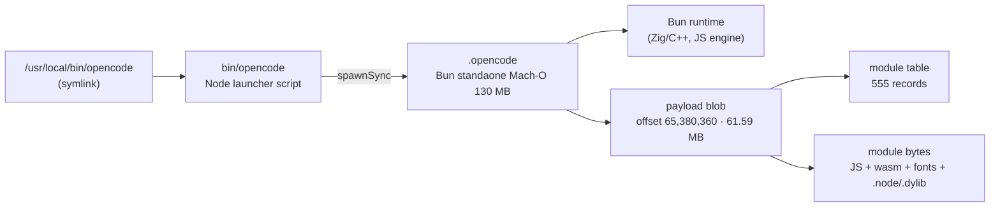

# 01 — Bundle anatomy: what is actually inside the binary

<!-- toc -->
## Contents

- [1. Three layers between `opencode` and your terminal](#1-three-layers-between-opencode-and-your-terminal)
  - [1.1 The launcher (`bin/opencode`) — [verified]](#11-the-launcher-binopencode--verified)
  - [1.2 The payload format — [verified]](#12-the-payload-format--verified)
  - [1.3 What is in the 555 modules — [verified]](#13-what-is-in-the-555-modules--verified)
  - [1.4 Bundle-internal structure — [verified]](#14-bundle-internal-structure--verified)
  - [1.5 Vendor content — [verified, aggregate]](#15-vendor-content--verified-aggregate)
  - [1.6 Why the "server" and "worker" split matters — [verified, see 03]](#16-why-the-server-and-worker-split-matters--verified-see-03)

<!-- /toc -->

## 1. Three layers between `opencode` and your terminal



### 1.1 The launcher (`bin/opencode`) — [verified]

It is a ~140-line Node script, not the app. Its only job is to find and `spawnSync` the right platform binary:

1. `OPENCODE_BIN_PATH` env override wins outright.
2. `scriptDir/.opencode` (the cached payload) is used when present — this is the path taken on this machine.
3. Otherwise it constructs `opencode-<platform>-<arch>[/-baseline][/-musl]` candidate names, probing
   `node_modules` upward from the script directory, and handles the AVX2 baseline distinction
   (`sysctl -n hw.optional.avx2_0` on macOS, `/proc/cpuinfo` on Linux).
4. If nothing is found it exits 1 with a message naming the packages it wanted.

**Why it exists:** npm can only ship one payload per platform; the wrapper defers the choice to install time and
keeps `opencode` runnable even when the platform package was installed into a hoisted `node_modules`. The
`.opencode` sibling file is the installation-time cache written by the package's `postinstall.mjs`.

### 1.2 The payload format — [verified]

Bun appends a serialized `StandaloneModuleGraph` to a copy of its own runtime:

```
[ bun runtime + code ] [ module bytes … ] [ module table ] [ Offsets ] [ "\n---- Bun! ----\n" ]
                                                          ^ 32 bytes, little endian
```

`Offsets` (32 bytes on Bun 1.3.9–1.4.x) is:

```c
struct Offsets {
  uint64 byte_count;             // size of the blob, excluding the trailer
  uint32 modules_off, modules_len;   // StringPointer into the blob
  uint32 entry_point_id;
  uint32 argv_off, argv_len;         // the compiled exec argv
  uint32 flags;                      // disable_default_env_files | disable_autoload_bunfig | …
};
```

Observed values for this binary: `byte_count = 64,585,314`, `modules_off = 64,556,406`,
`modules_len = 28,860`, `entry_point_id = 0`, `flags = 3` (`disable_default_env_files` |
`disable_autoload_bunfig`). `28,860 / 52 = 555`, which is how the 52-byte record size was confirmed rather than
assumed.

**Consequence worth knowing:** because offsets are relative to the blob start, and the trailer sits
732,070 bytes before EOF (the runtime pads the file), a naive `tail -c` scan finds the *literal* trailer string
that also appears inside the runtime image (two occurrences total, only one of them terminating the payload).

### 1.3 What is in the 555 modules — [verified]

| Kind | Count (examples) | Note |
|---|---|---|
| JS/TS/TSX (loader `js`, format `esm`, encoding `latin1`, side `server`) | 4 | `src/index.js`, `src/cli/cmd/tui/worker.js`, `@opentui/core/parser.worker.js`, `opencode-web-ui.gen.js` |
| WASM | tree-sitter grammars (json/ts/bash/powershell…), `resvg` | loaded for parsing/highlighting |
| Native | `watcher-*.node` (file watcher), `librust_pty-*.dylib` (PTY) | N-API / dylib |
| Assets | KaTeX fonts, PNG icons, `_headers` | embedded web UI |

**Only four JS modules exist.** That is the single most important structural fact for anyone reading this
document set: OpenCode's entire application — CLI, TUI, server, session engine, tools, providers — is bundled
into **one 22 MB ESM module** (`src/index.js`), and the server/worker half into **another** (`worker.js`). There
is no lazy `import()` of application code at runtime; Bun inlined the whole dependency graph.

### 1.4 Bundle-internal structure — [verified]

`src/index.js` opens with Bun's interop prelude and then a long sequence of module bodies introduced by
`// <original path>` comments:

```js
// @bun
var __create = Object.create;               // interop helpers
var __commonJS = (cb, mod) => () => (mod || cb((mod = { exports: {} }).exports, mod), mod.exports);
var __esm = (fn, res) => () => (fn && (res = fn(fn = 0)), res);   // lazy ESM initialiser

// src/flag/flag.ts
var Flag;
var init_flag = __esm(() => {
  Flag.OPENCODE_AUTO_SHARE = truthy("OPENCODE_AUTO_SHARE");
  …
});

// src/project/project.ts
var init_project = __esm(async () => {
  init_zod(); init_project_sql(); init_session_sql(); …   // explicit dependency init order
  await __promiseAll([init_db2(), init_log(), init_which(), init_run_service()]);
  ((Project) => { … })(Project ||= {});
});
```

Two mechanisms do all the work:

- **`__esm(fn)`** — a memoised module initialiser. First caller runs `fn` (which calls the `init_*` functions of
  its dependencies in a fixed order, `await`ing the async ones), later callers get the cached namespace.
  This is why every module body starts with a block of `init_<dep>()` calls: Bun flattened the ESM graph into an
  explicit topological initialisation sequence.
- **`__commonJS(cb)`** — lazy CommonJS: the factory runs once, then `mod.exports` is cached.
- Module namespaces are objects built by an IIFE with an assignment idiom: `((Session) => { … })(Session ||= {})`.
  That idiom is why this analysis can talk about `Session.create`, `Bus.publish`, `Permission.ask` as if the
  bundle had classes and namespaces — it effectively does.

**Engineering consequence [inferred]:** the explicit `init_*` calls plus lazy `__esm` give Bun's compiler a
deterministic, side-effect-ordered module graph without requiring runtime import resolution — the price is that
*every* module's dependency list is materialised as code, which is a large part of why the entry bundle is 22 MB.

### 1.5 Vendor content — [verified, aggregate]

3,291 of the 3,737 segments are `../../node_modules/**`, dominated by the AI SDK family (`@ai-sdk/*`,
`@openrouter/ai-sdk-provider`), Effect (`effect/*`), Drizzle ORM, zod, tree-sitter bindings, `@opentui/core`,
and TUI/formatting libraries. The appendix lists the full package breakdown. Practical takeaway: **the vendor
tree is larger than the application code by ~10×**, and reading the application requires filtering to `src/**`.

### 1.6 Why the "server" and "worker" split matters — [verified, see 03]

`src/index.js` and `worker.js` are two *separate* module graphs. `index.js` is the CLI/TUI process;
`worker.js` is what `new Worker(...)` loads in `thread.ts`, and it re-initialises its own copies of `Log`,
`Instance`, `Server`, `Bus`, `Config` from scratch. Any analysis that assumes shared module state between them
is wrong: they communicate **only** through the RPC bridge (`Rpc.client`/`Rpc.listen`) and HTTP-over-RPC.
