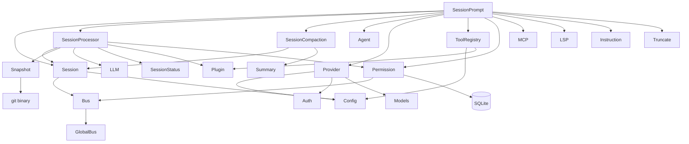

# 02 — Architecture

<!-- toc -->
## Contents

- [1. The four-layer picture — [verified]](#1-the-four-layer-picture--verified)
- [2. The Effect service model — [verified]](#2-the-effect-service-model--verified)
  - [2.1 Why Effect, and what it costs — [inferred, with verified evidence]](#21-why-effect-and-what-it-costs--inferred-with-verified-evidence)
  - [2.2 The child-process spawner (`effect/cross-spawn-spawner.ts`, 389 lines)](#22-the-child-process-spawner-effectcross-spawn-spawnerts-389-lines)
  - [2.2.1 `util/process.ts` (158 lines) — the promise wrapper over the same cross-spawn](#221-utilprocessts-158-lines--the-promise-wrapper-over-the-same-cross-spawn)
- [3. The per-directory instance model — [verified]](#3-the-per-directory-instance-model--verified)
  - [3.0 `State` — per-directory lifecycle (`project/state.ts`, 56 lines)](#30-state--per-directory-lifecycle-projectstatets-56-lines)
  - [3.1 The two Filesystem modules, and what path containment is](#31-the-two-filesystem-modules-and-what-path-containment-is)
  - [3.1.1 IDs and file ignores](#311-ids-and-file-ignores)
  - [3.1.2 `Wildcard` (`util/wildcard.ts`, 59 lines)](#312-wildcard-utilwildcardts-59-lines)
  - [3.2 Heap snapshots and user-facing errors (`cli/heap.ts` 53, `cli/error.ts` 44)](#32-heap-snapshots-and-user-facing-errors-cliheapts-53-clierrorts-44)
  - [3.2.1 Console state and TUI schema (`config/tui-schema.ts` 18, `config/console-state.ts` 14, `question/schema.ts` 14, `pty/schema.ts` 12, `sync/schema.ts` 11, `project/schema.ts` 11)](#321-console-state-and-tui-schema-configtui-schemats-18-configconsole-statets-14-questionschemats-14-ptyschemats-12-syncschemats-11-projectschemats-11)
  - [3.3 `BusEvent` and `Glob` (`bus/bus-event.ts` 29, `util/glob.ts` 28)](#33-busevent-and-glob-busbus-eventts-29-utilglobts-28)
- [4. Bus: the event spine — [verified]](#4-bus-the-event-spine--verified)
- [5. Dependency graph of the domain services — [verified from layer declarations]](#5-dependency-graph-of-the-domain-services--verified-from-layer-declarations)
- [6. Two processes, two module graphs — [verified]](#6-two-processes-two-module-graphs--verified)
- [7. Shared conventions across modules — [verified]](#7-shared-conventions-across-modules--verified)
- [8. The utility layer (`src/util/*`) — [verified, all 20 modules read]](#8-the-utility-layer-srcutil--verified-all-20-modules-read)
  - [8.1 `util/log.ts` (150 lines) and `util/flock.ts` (263) — the two large exclusions](#81-utillogts-150-lines-and-utilflockts-263--the-two-large-exclusions)

<!-- /toc -->

## 1. The four-layer picture — [verified]

```
┌────────────────────────────────────────────────────────────────────────────┐
│ L4  Clients                                                                │
│   TUI (SolidJS/@opentui)      CLI `run`        HTTP API        ACP/editor  │
└───────────────┬───────────────────┬───────────────┬────────────────┬───────┘
                │ RPC bridge        │ direct        │ HTTP+SSE       │ stdio JSON-RPC
┌───────────────▼───────────────────▼───────────────▼────────────────▼───────┐
│ L3  Transport / server                                                     │
│   Worker + Rpc (util/rpc)   Bun.serve + routes (server/**)  acp/agent.ts   │
└───────────────┬────────────────────────────────────────────────────────────┘
                │ in-process function calls (Effect services)
┌───────────────▼────────────────────────────────────────────────────────────┐
│ L2  Domain services  (Effect `ServiceMap.Service` + `Layer`)               │
│   Session · SessionPrompt · SessionProcessor · SessionCompaction · Retry   │
│   Provider · Agent · Command · ToolRegistry · Permission · Snapshot        │
│   LSP · MCP · Plugin · Config · Bus · Storage · File · Skill · Share      │
└───────────────┬────────────────────────────────────────────────────────────┘
┌───────────────▼────────────────────────────────────────────────────────────┐
│ L1  Infrastructure                                                          │
│   SQLite (Drizzle) · fs · ripgrep · git · Bun APIs · node child_process     │
│   AI SDK v5 providers · tree-sitter · PTY (librust_pty)                     │
└────────────────────────────────────────────────────────────────────────────┘
```

Layers are strict in one direction: L4 never touches L1 directly. Even the TUI's `fetch` is routed through the
worker's RPC `fetch` method, which then calls `Server.Default().fetch(...)`, which then reaches L2.

## 2. The Effect service model — [verified]

Every domain service follows an identical five-part shape. `src/bus/index.ts` is the smallest complete example:

```js
// 1. Tagged service identifier (a key in Effect's service map)
class Service3 extends ServiceMap.Service()("@opencode/Bus") {}
Bus.Service = Service3;

// 2. Layer: a generator that yields its dependencies and returns the implementation object
Bus.layer = Layer.effect(Service3, Effect.gen(function* () {
  const state2 = yield* InstanceState.make(/* per-directory state */);
  function publish4(def, properties) { … }
  return Service3.of({ publish: publish4, subscribe: subscribe4, … });
}));

// 3. A default layer wiring concrete dependencies (recursively composed)
// 4. A runtime built from the layer, exposing runPromise/runSync
const { runPromise, runSync } = makeRuntime4(Service3, Bus.layer);

// 5. Schema-validated module-level facade functions used by the rest of the codebase
Bus.publish = (def, props) => runPromise(svc => svc.publish(def, props));
Bus.subscribe = (def, cb) => runSync(svc => svc.subscribeCallback(def, cb));
```

Three consequences that shape the whole codebase:

1. **Dependencies are explicit and typed.** `SessionProcessor.layer` yields `Session.Service`,
   `Config.Service`, `Bus.Service`, `Snapshot.Service`, `Agent.Service`, `LLM.Service`, `Permission.Service`,
   `Plugin.Service`, `SessionStatus.Service` — nine dependencies visible in one place. There is no ambient
   singleton access inside service bodies.
2. **Construction is lazy and cached.** `Effect.gen` bodies run once per layer instantiation; `defaultLayer`
   compositions memoise per process.
3. **Errors are typed values, not exceptions.** `Schema.TaggedErrorClass` subclasses
   (`Permission.RejectedError`, `Session.BusyError`, `Runner.Cancelled`, `NotFoundError`) travel through
   `Effect.fail` and are pattern-matched with `isInstance`.

### 2.1 Why Effect, and what it costs — [inferred, with verified evidence]

Verified signals of intent: cancellation is threaded everywhere (`Effect.onInterrupt`, `Deferred`, `Fiber.interrupt`),
retry is declarative (`Schedule.fromStepWithMetadata` in `session/retry.ts`), concurrency is bounded with
`Effect.all({concurrency})`, and resource cleanup uses `addFinalizer`/`acquireUseRelease` (MCP transports).

That is exactly the feature set an agent runtime needs: streaming work that must be cancellable from a keystroke,
providers that fail and must back off, and per-directory state that must be torn down when a project is disposed.

The cost is visible too: the transpiled bundle is dense with `exports_Effect.gen(function* () {…})`, every
service needs a hand-written runtime bridge, and a stack trace through five layers is unreadable without the
`Effect.fn("Name")` spans the authors added deliberately (`"SessionProcessor.process"`, `"SessionPrompt.loop"`, …).

### 2.2 The child-process spawner (`effect/cross-spawn-spawner.ts`, 389 lines)

This module provides the `ChildProcessSpawner` service used by `Process.run/text` (the `Runner` in `16` §5), and it
is built on the **`cross-spawn` package** rather than Node's `child_process` — the same shim that resolves
`.cmd`/`.bat`/`.exe` shims on Windows and quote-escapes arguments. Beyond that, the whole point of writing it by
hand is to control process-group lifecycle and additional fds, which Effect's own spawner does not expose:

- **Detached by default.** Spawned with `{detached: options.detached ?? true, windowsHide: false}`. POSIX
  children are therefore process-group leaders and Windows children are tree roots, which makes group kills the
  normal path rather than an optimisation.
- **Group kill, platform-split.** `killGroup(proc, signal)` uses `process.kill(-proc.pid, signal)` on POSIX and
  shells out to `taskkill /pid <pid> /T /F` on `win32` (whole tree, forced, hidden). Both placements are tried in
  order: `killGroup` first, and `proc.kill(signal)` (`killOne`) as the catch-all fallback. Together with
  `killSignal ?? "SIGTERM"` and the optional `forceKillAfter` timeout that escalates to `SIGKILL`, the kill path is
  terminate → group → single → killall, four rungs instead of one.
- **Env/cwd handling.** `extendEnv` merges `{...process.env, ...env}`; otherwise the caller's `env` is passed
  verbatim. `cwd` is validated with `fs.access` and resolved to an absolute path before spawn, so a bad cwd fails
  *before* the process list rather than inside `spawn`'s error event.
- **Errors as platform tags.** `toTag` maps `errno` codes (`ENOENT`→`NotFound`, `EACCES`→`PermissionDenied`,
  `EEXIST`→`AlreadyExists`, `EISDIR|ENOTDIR|ELOOP`→`BadResource`, `EBUSY`→`Busy`, other→`Unknown`) and
  `toPlatformError` renders the full offending command line (`cmd arg | cmd arg`) into the error. A failed *spawn*
  completes the Deferred with this error, an `exit` completes it with the exit args — both paths run through the
  `proc.on("error")`/`proc.on("exit")` pair with interrupt synthesising a SIGTERM.
- **Additional fds.** Extra fds beyond 0-2 are modelled through Effect `Stream`/`Sink` wiring (`fromWritable` /
  `fromReadable` with `PassThrough`), and positional gaps are filled with `"ignore"`. `flatten9` reduces a
  `PipedCommand` pipeline into a list of commands with their pipe options; the default is `stdout → stdin` of the
  next stage, and `options.to` can target a specific fd name instead.
- The `defaultLayer` is the spawner plus `NodeFileSystem` and `Path` layers, and a lazy runtime (`run-service`)
  is created once per lazily-initialised process — matching the `Runner`'s runtime boundary. `windowsHide: false`
  is the opposite of the usual default: child console windows are visible.
  [inferred] The visibility is presumably deliberate — a failing `rg.exe` shows its own console rather than
  failing silently, which is consistent with the visible-console philosophy elsewhere in the codebase.


### 2.2.1 `util/process.ts` (158 lines) — the promise wrapper over the same cross-spawn

The module's service wants an Effect spawner; the rest of the codebase wants promises, so `Process` is a thin
promise wrapper over the same `cross-spawn` child — no Effect, no `ChildProcessSpawner`, no `Runner`:

```js
Process.spawn(cmd, opts) → {exitCode/signalCode, exited: Promise<number>, stdin/stdout/stderr, kill}
Process.run(cmd, opts)    → {code, stdout: Buffer, stderr: Buffer}; RunFailedError when code ≠ 0 and !nothrow
Process.text / .lines     → run() + stdout as string / split lines
Process.stop(proc)        → proc.kill() (SIGTERM); the taskkill fallback is compiled out by a constant guard
```

Subtleties, all verified from the source:

- `spawn`'s env handling: `env === null` means *empty environment*, otherwise `{...process.env, ...env}` or
  `undefined`. `windowsHide: false` matches the Effect spawner.
- Aborts: an `AbortSignal` triggers `proc.kill(opts.kill ?? "SIGTERM")`; if `opts.timeout` (default **5000 ms**,
  `<= 0` means never) elapses before exit, `SIGKILL` is sent. `kill` and `timeout` are the option names, so a
  timed-out child always dies even when it ignores SIGTERM.
- `run` collects stdout/stderr via `stream/consumers` `buffer()` over pipes; with `nothrow`, spawn failures
  collapse to `{code: 1, stdout: <empty>, stderr: <error message>}` instead of throwing.
- `RunFailedError` carries `{cmd, code, stdout, stderr}` with the message `"Command failed with code <N>: <cmd …>"`
  plus the trimmed stderr when non-empty.
- `stop()` is a deliberate no-op beyond `kill()`: the Windows `taskkill /pid … /T /F` fallback sits behind a
  constant-true guard in this build (`if (true) { proc.kill(); return; }`), the same pattern as §3.1.

## 3. The per-directory instance model — [verified]

OpenCode is single-process but multi-project. `src/effect/instance-state.ts` is the mechanism:

```js
InstanceState.context  = Effect.gen(function* () { return (yield* InstanceRef) ?? Instance.current; })
InstanceState.directory = Effect.map(InstanceState.context, ctx => ctx.directory)

InstanceState.make = (init) => Effect.gen(function* () {
  const cache = yield* ScopedCache.make({
    capacity: Number.POSITIVE_INFINITY,
    lookup: () => Effect.gen(function* () { return yield* init(yield* InstanceState.context); })
  });
  const off = registerDisposer(directory => Effect.runPromise(ScopedCache.invalidate(cache, directory)));
  yield* Effect.addFinalizer(() => Effect.sync(off));
  return { [TypeId]: TypeId, cache };
});

InstanceState.get = (self) => Effect.gen(function* () {
  return yield* ScopedCache.get(self.cache, yield* InstanceState.directory);
});
```

Read that carefully: **the cache key is the directory string**. Every service that needs per-project state
(Bus pubsubs, Session runners, Provider SDK instances, Permission pending map, Snapshot git dir, ToolRegistry
custom tools) calls `InstanceState.make`, and therefore gets one independent copy of that state per working
directory. `Instance.current` is an `AsyncLocalStorage`-style ambient context; `Instance.bind(fn)` re-enters it.

**Why this design [inferred]:** a single TUI can `chdir` between projects, and the HTTP server can serve several
directories at once. Keying state by directory gives isolation without spawning processes, and gives a cheap
disposal primitive — `registerDisposer` invalidates the cache entry, and each service's `addFinalizer` publishes
`Bus.InstanceDisposed` and shuts down its pubsubs (see `Bus.layer`).

**Limitation [verified + inferred]:** the key is a string; two different projects that are reachable through
different but equivalent paths (symlinks, `..`) would get separate state. The code mitigates this by consistently
resolving through `Filesystem.resolve` and using the git worktree as `ctx.worktree`, but nothing enforces
canonicalisation at the cache boundary.

### 3.0 `State` — per-directory lifecycle (`project/state.ts`, 56 lines)

`State.create(root, init, dispose)` returns a lazy getter keyed by `root()` — the first call for a given root
runs `init()` and memoises it in a module-level `recordsByKey: Map`; later calls return the same state.
`State.dispose(key)` runs every registered `dispose(state)` (only if one was provided), logging a warning if
disposal takes >10 s (unref'd timer so it can't hold the process open), catching per-entry errors with a
`log.error`, and finally clearing both maps. `dispose(key)` drops the records for that key only.

### 3.1 The two Filesystem modules, and what path containment is

There are two filesystems: `src/filesystem/index.ts` (197, the Effect `AppFileSystem` service) and
`src/util/filesystem.ts` (219, the plain-promise `Filesystem` namespace). They share the same helper surface —
`resolve`, `normalizePath`, `normalizePathPattern`, `windowsPath`, `overlaps`, `contains`, `findUp`, `up`,
`globUp`, `glob`, `exists`, `isDir/isFile`, `readJson/writeJson`, `mimeType` — and both build on the same
primitives; the Effect one additionally exposes `existsSafe` (an `exists` that never fails), `readDirectoryEntries`,
`ensureDir` and `writeWithDirs`. Anything documented about one is mostly true of the other.

The primitives, verified from the source:

- **`resolve(p)`** = `path.resolve(windowsPath(p))` → `realpathSync` → `normalizePath`. A missing (`ENOENT`)
  path does not fail: the *resolved* path is returned instead.
- **`normalizePath(p)`** makes the path absolute with `win32.normalize(win32.resolve(...))` and then hands it to
  `realpathSync.native` (kernel-real path), falling back to the resolved path on any error. `windowsPath`
  rewrites Git-Bash/WSL-style prefixes (`/c/…`, `/cygdrive/c/…`, `/mnt/c/…`, `/c:/…`) to `C:/…` letter-cased —
  posix.sh drive-letter tolerance that `path` itself never does.
- **`contains(parent, child)`** — the containment rule used by every `read`/`list` guard — is
  `!relative(parent, child).startsWith("..")`. Note this is a *string* test, not a canonical-path test: a `child`
  equal to `parent` yields rel `""` → contained; `../foo` → not. `overlaps(a, b)` is the symmetric
  `!relA.startsWith("..") || !relB.startsWith("..")`.
- **`normalizePathPattern(p)`** keeps a trailing `/*` intact while normalizing the directory part (with special
  handling for a bare `C:` → `C:\`).
- The `Effect` `up()` is an async generator yielding each found target while walking from `start` up to `stop`;
  `findUp()` collects *all* of them into an array (with `rootFirst` reversing for config-search reads).
- Both modules' `mimeType(p)` is a single lookup (`$lookup(p) || "application/octet-stream"`).

**Bundle artefact warning.** In the shipped 1.3.17 bundle the first statement of `normalizePath`,
`normalizePathPattern` and `windowsPath` in *both* modules is literally `if (true) return p;` — all normalization
is shadowed by a constant-true early return, and `resolve` still works only because its middle steps run. This is
verified behaviour of this build (not an inference), but whether the upstream source contains the guard or the
minifier folded a flag into it is [undetermined] — proof of impossibility: the upstream source is not in
this extracted bundle (only the minified `if (true) return p;` form is), so neither the `flag` in the
source nor the fold can be observed from available source by construction.

### 3.1.1 IDs and file ignores

`id/id.ts` (75) mints every entity id: a 10-type prefix map (`evt_`, `ses_`, `msg_`, `per_`, `que_`, `usr_`,
`prt_`, `pty_`, `tool`, `wrk_`), a prefix-validating `schema(prefix)`, and two orderings:
`ascending` (`timestamp_ms << 12 | counter`, 6 bytes big-endian hex) and `descending` (`~` of the same, so
granted ids read in reverse chronological order). `session/schema.ts` (27) brands the three hot ids — `SessionID` (*descending* — sessions sort newest-first by
default), `MessageID`/`PartID` (*ascending*) — each with a `make(id)` static and a prefix-backed zod schema;
`permission/schema.ts` (14) does the same for `PermissionID` (ascending). `create()` reuses the current ms and
bumps the 12-bit counter;
`timestamp(id)` reverses the encoding (`hex / 4096`). A given id is validated against the prefix and returned
as-is (idempotent mint). The random suffix is `randomBase62(14)` — `crypto.randomBytes` reduced mod 62
(accepting the tiny mod bias).

`file/ignore.ts` (68) is the built-in ignore list: 28 folders (node_modules, dist, build, .git, .turbo, .cache,
`__pycache__`, …), 11 file globs (`**/*.swp`, `**/.DS_Store`, `**/logs/**`, `**/*.log`, `**/coverage/**`, …);
`match()` consults a user whitelist first (never ignored), then the folder set (any path segment), then file
globs plus caller extras. This is the matcher behind `Glob`, `Grep` and file search (`File3.search`).

### 3.1.2 `Wildcard` (`util/wildcard.ts`, 59 lines)

`Wildcard.match(str, pattern)`: normalises `\` → `/` on both sides, escapes regex metachars, `*` → `.*`,
`?` → `.`, and — notably — `" .*"` (space + star) is rewritten to `" ( .*)?"` so `git *` matches plain `git`.
Flags `s`, anchored `^…$`. `Wildcard.all(input, map)` sorts patterns by `(length asc, key asc)` and returns the
**last** match — longest pattern wins. `allStructured`/`matchSequence` apply the same to `head`/`tail` token
lists with `*` as "any number of items", the engine behind permission rules like `"git *": "allow"` (`head =
git`, `tail` tokens matched).

### 3.2 Heap snapshots and user-facing errors (`cli/heap.ts` 53, `cli/error.ts` 44)

`Heap.start()` arms an hourly (60 s) watchdog **only under** `OPENCODE_AUTO_HEAP_SNAPSHOT`: if RSS exceeds
**2 GiB**, it writes one `v8.writeHeapSnapshot` to `<log dir>/heap-<pid>-<ISO-without-colons>.heapsnapshot` and
disarms until RSS drops back under the limit (hysteresis via the `armed` flag + the `lock` reentrancy guard);
write failures log and continue. The timer is unref'd; `lock`/`armed` are module-level singletons.

`FormatError` converts known domain errors into the exact prose users see: MCP failures
(`MCP server "<name>" failed. Note, opencode does not support MCP authentication yet.` — outdated by design but
still shipped); `ModelNotFoundError` (`Model not found: <provider>/<model>`, the suggestion list when present,
then `Try: opencode models …` and the config path pointer); `InitError` (credentials pointer); `JsonError`,
`ConfigDirectoryTypoError` (with the correction string), `FrontmatterError` (passed through), `InvalidError`
(`Configuration is invalid at <path>: <msg>` plus arrow-joined child issues), and `UI.CancelledError` → `""`
(the silent cancel). Anything else falls back to `errorFormat`.

### 3.2.1 Console state and TUI schema (`config/tui-schema.ts` 18, `config/console-state.ts` 14, `question/schema.ts` 14, `pty/schema.ts` 12, `sync/schema.ts` 11, `project/schema.ts` 11)

`TuiInfo = { $schema, theme, keybinds (a strict keybind-override object built from `Config.Keybinds.shape`),
plugin (Config.PluginSpec[]), plugin_enabled } + TuiOptions = { scroll_speed: ≥0.001, scroll_acceleration,
diff_style: auto|stacked, mouse }` (`.strict()` at both levels).
`ConsoleState = { consoleManagedProviders: string[], activeOrgName?, switchableOrgCount }` with an
empty default. `QuestionID`, `PtyID`, `EventID`, `WorkspaceID`, `ProjectID` (incl. the `"global"` constant) are
branded ids with `ascending` statics — the same minting family as §3.1.1.

Storage: `storage/db.bun.ts` (9) opens `bun:sqlite` with `create: true` and hands a drizzle instance;
`storage/schema.sql.ts` (8) exports the shared `Timestamps` ({time_created: default now, time_updated:
onUpdate now}) every table spreads in. `effect/instance-registry.ts` (13) is the disposer set behind
`State.dispose`; `effect/instance-ref.ts` (9) is the `~opencode/InstanceRef` service reference whose default
is a no-op. `bus/global.ts` (5) is a single process-wide `EventEmitter`. `util/data-url.ts` (10) parses data
URLs (`decodeURIComponent` or base64→UTF-8). `installation/meta.ts` (1 line) is just
`VERSION = "1.3.17"` + `CHANNEL = "latest"`. `cli/logo.ts` (5) is the block-letter logo fragments.

### 3.3 `BusEvent` and `Glob` (`bus/bus-event.ts` 29, `util/glob.ts` 28)

`BusEvent.define(type, properties)` registers every event the bus can emit into one module-level `Map`; at
`payloads()` it builds a zod `discriminatedUnion("type", …)` for the whole registry with `Event.<type>` refs —
this becomes the generated `Event` schema consumers validate with. `Glob.scan/scanSync` are `bun:glob` wrappers:
`symlink` maps to `follow` (false by default), `include !== "all"` adds `nodir`, `dot` passes through; and
`Glob.match` is plain minimatch with `dot: true`.

`env/index.ts` (28) is `Instance.state(() => ({...process.env}))` with `get/all/set/remove` — a process.env
mirror per instance so tests/code can mutate without touching the real env.

## 4. Bus: the event spine — [verified]

`src/bus/index.ts` implements a two-channel pubsub per instance:

- one **wildcard** `PubSub.unbounded` for every event, and
- a **typed** `PubSub.unbounded` created lazily per event type (`getOrCreate`).

`publish` writes to the typed channel (if one exists) *and* the wildcard channel, then calls
`GlobalBus.emit("event", { directory, payload })`. `GlobalBus` is process-global, which is how events cross the
worker→thread boundary: `worker.ts` subscribes to `GlobalBus` and forwards everything over RPC as `global.event`,
while `startEventStream` separately re-emits per-instance bus traffic as `event`.

**Design rationale [inferred]:** typed channels let listeners subscribe cheaply to one event type without
filtering; the wildcard channel is what makes the "stream everything to the client" TUI model possible; the
global bus is the seam that survives process/worker boundaries.

**Consequence [verified]:** unbounded queues mean a slow consumer cannot apply backpressure — it grows memory
instead. There is no drop policy, no size cap, and no per-subscriber buffer limit in this module.

## 5. Dependency graph of the domain services — [verified from layer declarations]



Cycles are avoided by two rules visible in the code: **Session is the lowest domain service** (it never yields
`SessionPrompt`), and **Prompt/Processor depend on each other only through the `processor` service handle**
(`processor.create(...)` returns a per-turn handle object with `process`/`abort`, not a service dependency).

## 6. Two processes, two module graphs — [verified]

`src/cli/cmd/tui/thread.ts` spawns `worker.js` and talks to it over `Rpc`:

| Concern | UI thread (`index.js`) | Worker (`worker.js`) |
|---|---|---|
| Rendering | Solid/OpenTUI renderer | none |
| `Server` | never constructed | `Server.Default()` / `Server.listen()` |
| SQLite | writes? *[undetermined — DB is opened lazily in whichever graph first touches it]* | opens DB, runs migrations, owns writes via services |
| `fetch` to API | proxied: `Rpc.call("fetch")` → worker `fetch` → `Server.Default().fetch` | real handler |
| Events | `EventSource` created from `Rpc.on("event")` | `startEventStream` + `Rpc.emit("event")` |
| Bus | re-publishes nothing; consumes | owns `Instance`-scoped bus, forwards `GlobalBus` |

`thread.ts` chooses the transport at runtime:

```js
const external = process.argv.includes("--port") || … || network.port !== 0 || network.hostname !== "127.0.0.1";
const transport = external
  ? { url: (await client.call("server", network)).url, fetch: undefined, events: undefined }
  : { url: "http://opencode.internal", fetch: createWorkerFetch(client), events: createEventSource(client) };
```

**Why the fake origin `http://opencode.internal` [inferred]:** the SDK and tooling expect URLs; using a
synthetic origin lets the TUI construct `createOpencodeClient({ baseUrl: "http://opencode.internal", fetch })`
and get identical code paths for local and remote operation, while the actual `fetch` is intercepted and
tunnelled through the worker. It also means no TCP port is opened in the default case — a deliberate
security/portability choice (no listener, no port conflicts, nothing to firewall).

## 7. Shared conventions across modules — [verified]

| Convention | Evidence | Purpose |
|---|---|---|
| Zod for every boundary | `Session.Info`, `Permission.Request`, `Config.Info`, tool `parameters` | single source of truth for validation + JSON Schema for the API |
| `SyncEvent.define` vs `BusEvent.define` | `session/index.ts` uses both | `SyncEvent` = replicated/aggregated client state; `BusEvent` = ephemeral notification |
| ID kinds with direction | `SessionID.descending`, `MessageID.ascending`, `PartID.ascending` | ordering by ID, no `createdAt` sort needed |
| `Log.create({service})` per module | every service | structured, scoped logging |
| `Flag.*` for env config | `src/flag/flag.ts` | one place turns env into typed booleans |
| `Instance.path` vs `InstanceState` | `project/instance.ts` | ambient vs cached per-directory |
| Tool text as separate `.txt` modules | `src/tool/*.txt` | prompts ship with the tool that needs them |

---

## 8. The utility layer (`src/util/*`) — [verified, all 20 modules read]

492 lines across twenty modules, none over 100 lines. Individually trivial, collectively the reason timeouts,
retries, path lookup and token budgeting behave the same way everywhere — and the place where several
cross-cutting decisions are actually made.

| Module | Lines | What it is | Main call sites |
|---|---:|---|---|
| `util/context.ts` | 31 | `AsyncLocalStorage` wrapper: `create(name)` → `{use, provide}`; `use()` throws `Context.NotFound(name)` when no value is bound. | `project/instance.ts` (`Context2.create("instance")`), `storage/db.ts` (`"database"`) |
| `util/timeout.ts` | 14 | `withTimeout(promise, ms)` — `Promise.race` plus `clearTimeout` on success; rejects `Operation timed out after Nms`. | LSP client (45 s), MCP, TUI thread |
| `util/abort.ts` | 17 | `abortAfter(ms)` and `abortAfterAny(ms, ...signals)` (timer + `AbortSignal.any`). | `tool/{websearch,webfetch,codesearch}.ts` — per-call deadlines |
| `util/effect-http-client.ts` | 9 | `withTransientReadRetry` = `HttpClient.retryTransient{retryOn:"errors-and-responses", times:2, exponential(200) jittered}`. | `account`, `installation`, `skill/discovery`, `session/instruction` |
| `util/token.ts` | 10 | `Token.estimate(s) = round(len/4)` — `CHARS_PER_TOKEN = 4`. | `session/compaction.ts` (the context budget) |
| `util/which.ts` | 16 | `which(cmd, env?)` — searches `PATH` **plus `Global.Path.bin`**, honours `PATHEXT`, `nothrow`, returns `null`. | `file/ripgrep`, `shell/shell`, `lsp/server`, TUI clipboard |
| `util/hash.ts` | 10 | `Hash.fast = sha1(input)` hex. | cache keys (`provider/models`, `provider/provider`), `flock` names, `snapshot` |
| `util/lazy.ts` | 20 | single-shot memo with `reset()`. | `file/{watcher,ripgrep}`, `shell/shell`, `provider/models` |
| `util/queue.ts` | 23 | `AsyncQueue` — `push`/`next`/`Symbol.asyncIterator`, resolvers resolved in FIFO order. | `server/routes/{event,global,tui}.ts` — SSE fan-in |
| `util/effect-zod.ts` | 96 | Effect `Schema` AST → zod object, walking `String/Number/Boolean/Null/Undefined/Any/Unknown/Never/Literal/Union/Objects/Arrays/Declaration` and optionals; throws `unsupported effect schema: <ref>` for anything else (no tuples, template literals, dates, bigints). | `auth/index.ts` only |
| `util/update-schema.ts` | 10 | `updateSchema(zodObject)` → same shape with every key `.nullable()`. | `session/index.ts` update endpoints |
| `util/schema.ts` | 12 | `Newtype()` / `withStatics` — branded-schema helper. | `permission/schema`, `question/schema` |
| `util/fn.ts` | 21 | `fn(schema, cb)` — parse then call; `.force(input)` bypasses validation; `.schema` exposes it. On failure it prints `console.trace` + `console.error(issues)`. | throughout |
| `util/error.ts` | 73 | `errorFormat` / `errorMessage` / `errorData` — total functions: stack for `Error`, `JSON.stringify` for objects, property-wise string coercion otherwise; never throws. | error surfaces everywhere |
| `util/locale.ts` | 81 | human formatting: `time`, `datetime`, `todayTimeOrDateTime`, `number` (K/M), `duration` (ms), `truncate`, `truncateMiddle`, `pluralize`, `titlecase`. | TUI routes/components, CLI `session list` |
| `util/format.ts` | 22 | `formatDuration(secs)` — `12s`, `4m 3s`, `2h 10m`, `~3 days`, `~2 weeks`. | prompt component |
| `util/record.ts` | 3 | `isRecord` — plain-object test used as the guard in half the codebase. | config, plugin install, `error.ts` |
| `util/archive.ts` | 11 | `Archive.extractZip` → shells out to `unzip -o -q`. The Windows `Expand-Archive` branch is **compiled out** (`if (false)`), so this binary requires a system `unzip`. | `lsp/server.ts` (downloaded servers) |
| `util/defer.ts` | 10 | `defer(fn)` → `{[Symbol.dispose], [Symbol.asyncDispose]}`. | explicit resource management in scoped code |
| `util/iife.ts` | 3 | `iife(fn)` — identity call. | a few module-level initialisers |

### 8.1 `util/log.ts` (150 lines) and `util/flock.ts` (263) — the two large exclusions

The table above is twenty small modules; two larger ones were documented elsewhere and are summarised here for
completeness — `flock.ts` in full at `16` §9.3.1, `log.ts` below.

`Log` is a per-service tag system with a single global level. `Log.create({service})` caches one logger per
service name (so `Log.create({service: "file"})` always returns the same instance), and the four methods are
always present — the level test (`levelPriority[gated] >= levelPriority[level]`) happens *inside* each call, so
code can call `log.debug` freely and a DEBUG log is dropped at the gate. `Log.Default` is the logger for
`"default"`. The log *format* is constant: `<ISO-8601> +<delta since previous log> key=value … message`, where
errors render their full `cause` chain recursively (`formatError2`, depths ≤ 10, joined with `" Caused by: "`),
objects are `JSON.stringify`'d, null/undefined tags are dropped, and `time(msg, extra)` logs `"started"` and
returns a `[Symbol.dispose]`-compatible stopper that logs `"completed"` with `duration` — the `using` idiom again.

`Log.init({level, print, dev})` points the sink: with `print` the sink is stderr; otherwise a new
`<Global.Path.log>/<ISO timestamp>.log` file (or `dev.log` in dev mode) is truncated and appended to. Cleanup
runs on init and trims the log directory to the newest **10** files (files are ISO-timestamp-named, so a lexical
sort is a chronological sort; the `files.length <= 5` early-exit means deletion only ever happens once the
directory holds more than 10). Errors are never lost by cleanup: every `unlink` swallows its own failure.

Three things worth knowing beyond the table:

- **`util/context.ts` is how `Instance` escapes Effect.** `project/instance.ts` creates the `"instance"`
  `AsyncLocalStorage`; `storage/db.ts` creates `"database"`; `Instance.bind` wraps a callback in `provide` so
  non-Effect code can still read the current directory. `Context.NotFound` is deliberately a *typed* signal:
  `effect/instance-state.ts` and `effect/run-service.ts` catch it to mean "no ambient instance, fall back to the
  Effect fiber's `InstanceRef`" (§3).
- **Two duration formatters, one of them wrong.** `util/format.formatDuration(secs)` and
  `Locale.duration(ms)` both exist in different layers. `Locale.duration`'s day branch computes
  `days = floor(input % 3600000 / 86400000)`, which is always `0`, so anything over a day renders as
  `"0d 24h"`, `"0d 48h"`, … The formatter is only used by the session route, so the bug is cosmetic — but it is
  in the branch that was clearly meant to print days.
- **`util/fn.ts` writes to the console, not the logger.** A schema-validation failure dumps a stack trace and
  pretty-printed issues to stdout/stderr, bypassing `Log`. In the TUI that lands in the terminal behind the
  alternate screen; in `run --format json` it corrupts stdout framing.

[verified] Timeout policy is split by transport rather than centralised: promise-level (`withTimeout`), signal-level
(`abortAfter`/`abortAfterAny`) and HTTP-level (`withTransientReadRetry`). Nothing enforces which one a new call site
uses; the three web tools each happen to pick `abortAfterAny` for the same purpose.
