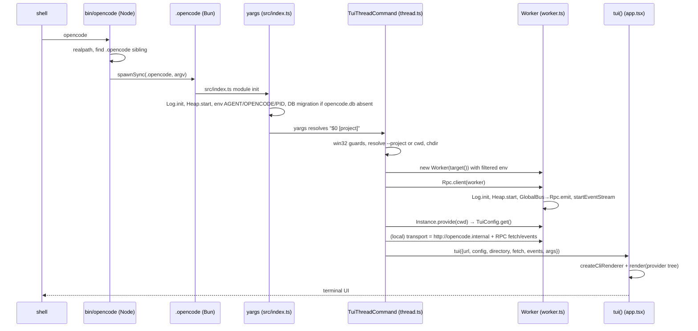
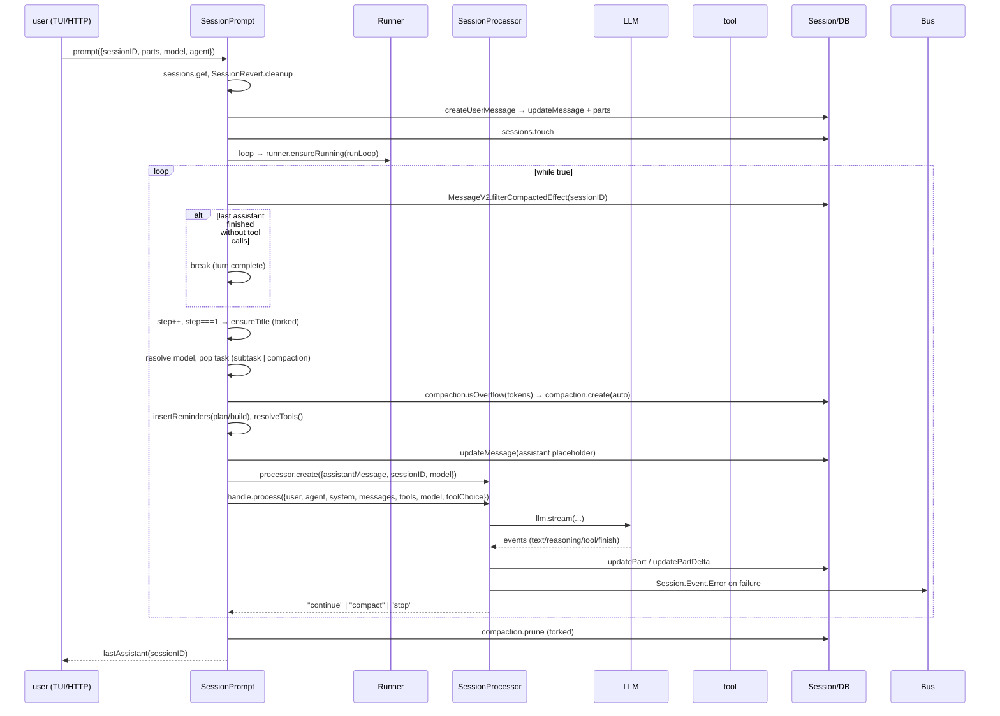
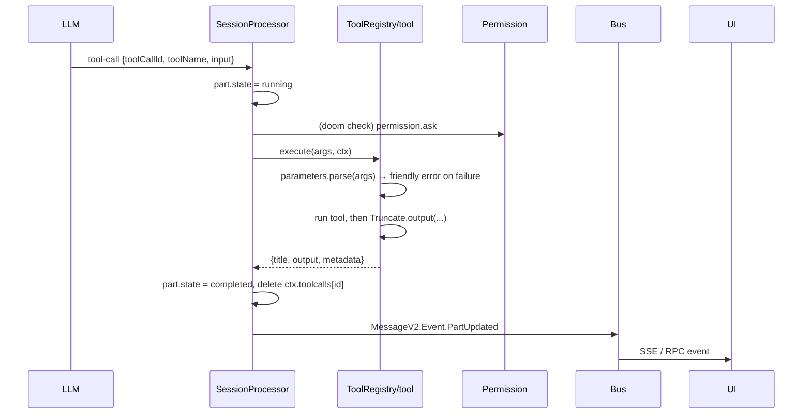
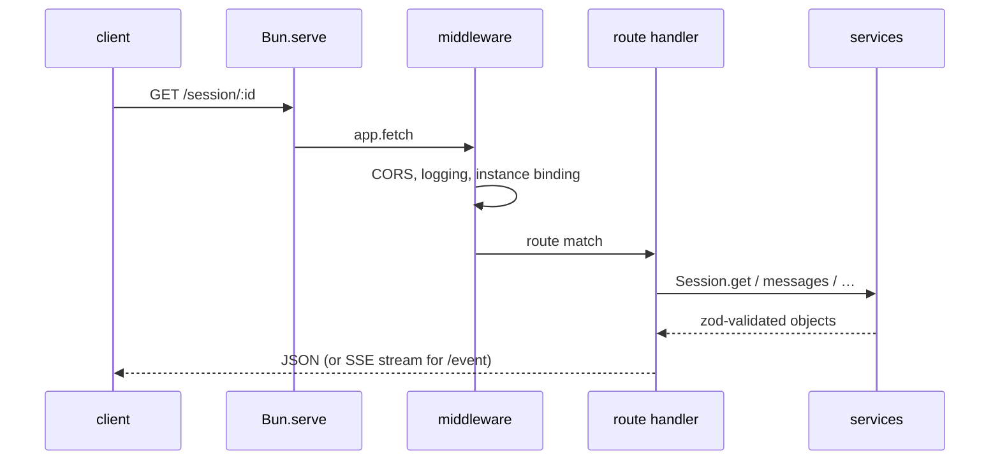

# 03 — Execution flows (traced end to end)

<!-- toc -->
## Contents

- [1. `opencode` (bare) → a rendered TUI](#1-opencode-bare--a-rendered-tui)
  - [Step detail](#step-detail)
- [2. One user prompt → assistant turn → tool call → next step](#2-one-user-prompt--assistant-turn--tool-call--next-step)
  - [2.1 Entry: `SessionPrompt.prompt` (bundle 1104–1127)](#21-entry-sessionpromptprompt-bundle-11041127)
  - [2.2 Serialisation: `Runner` (`src/effect/runner.ts`)](#22-serialisation-runner-srceffectrunnerts)
  - [2.3 The step body (bundle 1117–1335)](#23-the-step-body-bundle-11171335)
  - [2.4 `SessionProcessor.process` — the streaming event switch](#24-sessionprocessorprocess--the-streaming-event-switch)
  - [2.5 Outcome semantics](#25-outcome-semantics)
  - [2.6 Retry (`src/session/retry.ts`)](#26-retry-srcsessionretryts)
- [3. A single tool call, end to end](#3-a-single-tool-call-end-to-end)
- [4. One HTTP request (server mode)](#4-one-http-request-server-mode)

<!-- /toc -->

Every trace below is from the shipped code. Line numbers refer to the extracted `index.js` / `worker.js`;
module paths refer to the preserved `// src/...` markers.

---

## 1. `opencode` (bare) → a rendered TUI



### Step detail

1. **`src/index.ts` (bundle 576k–581k)** — top-level side effects run before yargs:
   `process.on("unhandledRejection"|"uncaughtException")` → `Log.Default.error`; middleware sets `OPENCODE=1`,
   `AGENT=1`, `OPENCODE_PID`, initialises logging, starts the heap sampler, and performs a **one-time SQLite
   migration** if `Global.Path.data/opencode.db` is missing (progress bar on TTY, `sqlite-migration:<pct>` otherwise).
2. **Command registration order matters** — `TuiThreadCommand` is registered first among the "interactive"
   commands and declares `command: "$0 [project]"` (bundle 581874, 577544), so bare `opencode` dispatches to it.
3. **`thread.ts` handler** (bundle 577600–577700): guards → `--fork` validation → resolve project path →
   `target()` (worker.js / worker.ts) → `chdir` → `new Worker(file, { env })` → `Rpc.client` → register
   `SIGUSR2`→`reload`, `uncaughtException`→log → `Instance.provide({directory: cwd, fn: TuiConfig.get})`.
4. **Transport decision** — `external` is true if any of `--port`, `--hostname`, `--mdns` was passed or the
   resolved network options differ from `127.0.0.1:0`. External → ask the worker to start a real server and use
   its URL; internal → synthetic origin + RPC-backed `fetch`/events.
5. **`tui()`** (`app.tsx`, bundle 576552): `getTerminalBackgroundColor()` (OSC 11 query, 1 s timeout, defaults to
   dark), `createCliRenderer(rendererConfig(config))`, then the provider tree
   `ErrorBoundary → ArgsProvider → ExitProvider → KVProvider → ToastProvider → RouteProvider → TuiConfigProvider →
   SDKProvider → SyncProvider → ThemeProvider → LocalProvider → KeybindProvider → PromptStash → Dialog →
   Command → Frecency → PromptHistory → PromptRef → App`.
6. **Cleanup** — `finally { await stop() }`: RPC `shutdown` with a 5 s `withTimeout`, then `worker.terminate()`.

[verified] One detail worth knowing for extension authors: `target()` prefers `OPENCODE_WORKER_PATH`, then
`./cli/cmd/tui/worker.js` next to the running module, then `./worker.ts` — the last branch only resolves in a
dev checkout.

---

## 2. One user prompt → assistant turn → tool call → next step

This is the core loop, `SessionPrompt.runLoop` (`src/session/prompt.ts`, bundle 1117–1335).



### 2.1 Entry: `SessionPrompt.prompt` (bundle 1104–1127)

```js
const prompt2 = Effect.fn("SessionPrompt.prompt")(function* (input) {
  const session = yield* sessions.get(input.sessionID);
  yield* Effect.promise(() => SessionRevert.cleanup(session));      // undo pending revert state
  const message = yield* createUserMessage(input);
  yield* sessions.touch(input.sessionID);
  const permissions = [];
  for (const [t, enabled] of Object.entries(input.tools ?? {}))
    permissions.push({ permission: t, action: enabled ? "allow" : "deny", pattern: "*" });
  if (permissions.length > 0) {
    session.permission = permissions;
    yield* sessions.setPermission({ sessionID: session.id, permission: permissions });
  }
  if (input.noReply === true) return message;                        // prompt-only, no model call
  return yield* loop2({ sessionID: input.sessionID });
});
```

Notable decisions:

- **`noReply`** exists so callers can append context without triggering inference (used by command/subtask paths).
- **Per-session tool overrides** are materialised as permission rules (`allow`/`deny` on `*`) and persisted on the
  session row, so they survive restarts and apply to every later turn — not just this one.
- **`SessionRevert.cleanup`** runs before a new message: reverting is a state on the session, and sending a new
  prompt finalises it.

### 2.2 Serialisation: `Runner` (`src/effect/runner.ts`)

`loop2` never runs the loop directly; it goes through a per-session `Runner`:

```js
const getRunner = (runners, sessionID) => {
  const existing = runners.get(sessionID); if (existing) return existing;
  const runner = Runner.make(scope3, {
    onIdle: Effect.gen(function* () { runners.delete(sessionID); yield* status.set(sessionID, {type:"idle"}); }),
    onBusy: status.set(sessionID, {type:"busy"}),
    onInterrupt: lastAssistant(sessionID),
    busy: () => { throw new Session.BusyError(sessionID); }
  });
  runners.set(sessionID, runner); return runner;
};
```

`Runner` is a four-state machine held in a `SynchronizedRef`:

```
Idle ──ensureRunning──► Running ──exit──► Idle
Idle ──startShell────► Shell    ──ensureRunning──► ShellThenRun ──shell exits──► Running
```

- A second `loop` call while `Running` **does not** start a second run; it awaits the existing `Deferred`
  (`return [Deferred.await(st2.run.done), st2]`). That is how "type another message while the agent is working"
  is coalesced rather than forked.
- `startShell` refuses when not `Idle` and calls `opts.busy()` (→ `Session.BusyError`) — a user shell (`!cmd`)
  and an agent turn cannot run simultaneously in one session.
- Cancellation is `Fiber.interrupt` + `Deferred.await` + `idleIfCurrent()`; interrupted-only exits surface as
  `Runner.Cancelled`, which `ensureRunning` converts to `onInterrupt` (returns the last assistant message) rather
  than an error.

[inferred] This is the code-level answer to "why does `esc` cancel cleanly but the session stays usable":
interruption is an expected outcome with its own result path, not an exception.

### 2.3 The step body (bundle 1117–1335)

Ordered responsibilities, each with a reason visible in the code:

| Step | Code | Why it is there |
|---|---|---|
| Load history | `MessageV2.filterCompactedEffect(sessionID)` | compaction replaces ranges; the loop must see only live messages |
| Reverse scan | finds `lastUser`, `lastAssistant`, `lastFinished`, collects `compaction`/`subtask` parts | decides "done?" and "what task is pending?" in one pass |
| Exit test | `lastAssistant.finish && !["tool-calls"].includes(finish) && !hasToolCalls && lastUser.id < lastAssistant.id` | a finished assistant with no tool calls ends the turn. `unknown` finish is *not* in the exclusion list here, so it also ends the turn |
| Title | `step === 1 → ensureTitle(...)` forked | costs an LLM call; must never block the turn |
| Task queue | `tasks.pop()` → `subtask` or `compaction` | subtasks (agent delegation) and compaction are modelled as *parts on user messages*, so they survive restarts and are ordered with the conversation |
| Overflow | `compaction.isOverflow({tokens, model})` → `compaction.create({auto:true})` then `continue` | context management happens in the loop, not inside the processor |
| Agent resolution | `agents.get(lastUser.agent)`; on miss → `Session.Event.Error` + throw with available agent names | agents are configuration; a stale name must fail loudly with a fix hint |
| Max steps | `agent.steps ?? Infinity`; `isLastStep` appends `max_steps_default` to messages | a hard per-turn budget expressed *as a message*, so the model is told to wrap up rather than being silently cut |
| Reminders | `insertReminders({messages, agent, session})` | plan-mode constraints and build-switch notices injected as synthetic text parts |
| Assistant placeholder | `MessageID.ascending()` + `updateMessage` | the UI can render the bubble before the first token |
| Turn | `processor.create(...)` → `handle.process(...)` | see §2.4 |
| Structured output | `lastUser.format?.type === "json_schema"` adds a `StructuredOutput` tool and `toolChoice:"required"`; missing output → `StructuredOutputError` | schema-constrained answers are a tool call, not prose parsing |
| Late user messages | step > 1: any user text after `lastFinished` is wrapped in `<system-reminder>` | a mid-turn message is delivered as an instruction to continue, not as a new turn |
| Plugins | `plugin.trigger("experimental.chat.messages.transform", …)` before building messages | lets plugins rewrite the prompt assembly |

### 2.4 `SessionProcessor.process` — the streaming event switch

`src/session/processor.ts` creates a **per-turn context object** and reduces provider stream events into parts:

```js
const ctx = { assistantMessage, sessionID, model, toolcalls: {}, shouldBreak: false,
              snapshot: initialSnapshot, blocked: false, needsCompaction: false,
              currentText: undefined, reasoningMap: {} };
```

| Event | Behaviour | Rationale |
|---|---|---|
| `start` | `status.set(sessionID, {type:"busy"})` | status is separate from events so the UI can show "working" before tokens arrive |
| `reasoning-start/delta/end` | creates a `reasoning` part, appends deltas, trims on end | reasoning is streamed and persisted incrementally so a crash keeps what arrived |
| `tool-input-start` | **throws** if `assistantMessage.summary` | hard invariant: a summarisation pass may not call tools |
| `tool-call` | marks part `running`, then **doom-loop check** | see below |
| `tool-result` | part → `completed` with `output/metadata/title/attachments`, deletes from `ctx.toolcalls` | |
| `tool-error` | part → `error`; `Permission.RejectedError`/`Question.RejectedError` set `ctx.blocked = ctx.shouldBreak` | a rejection is not a failure — it stops the loop instead |
| `start-step` | ensures a snapshot exists; writes `step-start` part with the hash | |
| `finish-step` | cost/token accounting, `step-finish` part, `snapshot.patch(hash)` → `patch` part, `SessionSummary.summarize`, overflow check | one place computes usage and diff |
| `text-start/delta/end` | text part streaming; `end` runs `plugin.trigger("experimental.text.complete")` | plugins can post-process assistant text |
| `error` | `throw` → caught by `halt` | |

**Doom-loop detection** (`DOOM_LOOP_THRESHOLD = 3`):

```js
const recentParts = MessageV2.parts(ctx.assistantMessage.id).slice(-3);
if (recentParts.length === 3 &&
    recentParts.every(p => p.type === "tool" && p.tool === value9.toolName &&
                          p.state.status !== "pending" &&
                          JSON.stringify(p.state.input) === JSON.stringify(value9.input)))
  yield* permission.ask({ permission: "doom_loop", patterns: [value9.toolName], … });
```

Three identical consecutive tool calls with identical inputs trigger a **permission prompt**, not a hard stop.
`JSON.stringify` as an equality function is order-sensitive: semantically identical inputs with different key
order will not match — a real (minor) false-negative, not a false-positive.

**Failure handling** — three distinct paths:

- `halt(e)` — logs, `MessageV2.fromError`, publishes `Session.Event.Error`, sets status idle. Special case:
  `ContextOverflowError` sets `needsCompaction = true` **instead of** marking the message failed.
- `abort()` — only synthesises an `AbortError` if the message has no error yet; then `cleanup()` if incomplete.
- `cleanup()` — closes snapshots (writes a `patch` part), finalises a dangling text part, finalises reasoning
  parts, marks any still-`running` tool part as `error: "Tool execution aborted"`, stamps
  `time.completed`, persists the message.

[inferred] `cleanup` is the "no half-written turns" guarantee: every path out of `process` runs it via
`Effect.ensuring(cleanup())`, so the DB never contains a `running` tool part after the turn ends.

### 2.5 Outcome semantics

```js
if (ctx.needsCompaction) return "compact";
if (ctx.blocked || ctx.assistantMessage.error || aborted) return "stop";
return "continue";
```

`"compact"` makes the caller create a compaction and `continue` the loop; `"stop"` breaks it; `"continue"`
re-enters with the tool results appended. This three-valued result is the entire control contract between the
processor and the prompt loop.

### 2.6 Retry (`src/session/retry.ts`)

Applied at the process boundary:

```js
Effect.retry(SessionRetry.policy({
  parse: parse13,
  set: info => status.set(ctx.sessionID, { type: "retry", attempt: info.attempt, message: info.message, next: info.next })
}))
```

- Backoff: `2000 * 2^(attempt-1)`, capped at **30 s** when the provider sent no headers, otherwise capped at
  `2^31-1` ms.
- Header-driven: `retry-after-ms`, `retry-after` (seconds **or** HTTP-date via `Date.parse`).
- Classification (`SessionRetry.retryable`): `ContextOverflowError` never retries; `APIError` retries only if
  `isRetryable`; specific message rewrites — `FreeUsageLimitError` → "Free usage exceeded, subscribe to Go …",
  `Overloaded` → "Provider is overloaded"; JSON-body heuristics detect `too_many_requests`, `exhausted`,
  `unavailable`, `rate_limit`.
- The retry wait is surfaced to the UI (`status.set(... {type:"retry", next})`) so the countdown is visible.

**Why classify at all [inferred]:** providers report overload in a dozen incompatible shapes; a single
normaliser keeps the loop's error path small and the UX consistent.

---

## 3. A single tool call, end to end



The registry side is two mechanisms: builtins (`bash`, `edit`, `read`, `write`, `glob`, `grep`, `task`, `todo`,
`webfetch`, `websearch`, `codesearch`, `skill`, `apply_patch`, `lsp`, `batch`, `question`, `invalid`, `plan`)
wrapped by `Tool.define`, plus **user/plugin tools** discovered by globbing `{tool,tools}/*.{js,ts}` in every
config directory and importing each file:

```js
const namespace = path.basename(match, path.extname(match));
const mod = await import(pathToFileURL(match).href);
for (const [id, def] of Object.entries(mod))
  custom.push(fromPlugin(id === "default" ? namespace : `${namespace}_${id}`, def));
```

[inferred] `namespace_id` naming avoids collisions between files and exports while keeping a single export file
(`export default {...}`) named after its file.

---

## 4. One HTTP request (server mode)



Server construction is `Server.ControlPlaneRoutes()` → `Bun.serve({ hostname, idleTimeout: 0, fetch, websocket })`.
Port `0` tries **4096 first**, then a random port; if both fail it throws
`Failed to start server on port <n>`. `idleTimeout: 0` disables Bun's idle cutoff because agent turns can be
silent for minutes while a tool runs. mDNS publishing is skipped unless the bind host is non-loopback.

`Server.openapi()` generates an OpenAPI **3.1.1** document from the same route definitions
(`generateSpecs`), i.e. the routes are declared once and documented from the declaration.
