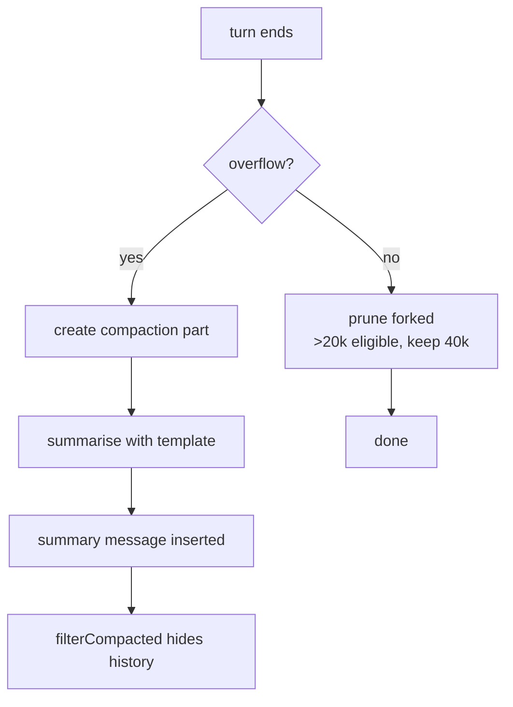

# 04 — The session engine

<!-- toc -->
## Contents

- [1. `Session` — the durable aggregate (`src/session/index.ts`, 585 lines)](#1-session--the-durable-aggregate-srcsessionindexts-585-lines)
  - [1.1 Shape](#11-shape)
  - [1.2 Title generation policy](#12-title-generation-policy)
  - [1.3 Service surface](#13-service-surface)
  - [1.4 `BusyError` and the concurrency contract](#14-busyerror-and-the-concurrency-contract)
- [2. `MessageV2` — messages as ordered parts](#2-messagev2--messages-as-ordered-parts)
- [3. `SessionProcessor` — see 03 §2.4 for the event table](#3-sessionprocessor--see-03-24-for-the-event-table)
- [4. `SessionCompaction` — context management (`src/session/compaction.ts`)](#4-sessioncompaction--context-management-srcsessioncompactionts)
  - [4.1 Overflow detection](#41-overflow-detection)
  - [4.2 Pruning — cheap, lossless-ish trimming of old tool output](#42-pruning--cheap-lossless-ish-trimming-of-old-tool-output)
  - [4.3 Summarisation — replacing history with a prompt-shaped summary](#43-summarisation--replacing-history-with-a-prompt-shaped-summary)
  - [4.4 How the three interact](#44-how-the-three-interact)
- [5. `SyncEvent`, projectors and the write path](#5-syncevent-projectors-and-the-write-path)
- [6. `SessionRetry` — see 03 §2.6 (constants and classification table)](#6-sessionretry--see-03-26-constants-and-classification-table)
- [7. `SessionStatus` — three states, one map](#7-sessionstatus--three-states-one-map)
- [8. `SessionRevert` and the snapshot coupling](#8-sessionrevert-and-the-snapshot-coupling)
- [9. Instruction files — `AGENTS.md`, `CLAUDE.md`, `CONTEXT.md` (`src/session/instruction.ts`, 197 lines)](#9-instruction-files--agentsmd-claudemd-contextmd-srcsessioninstructionts-197-lines)
  - [9.1 What is searched](#91-what-is-searched)
  - [9.2 System prompt: `systemPaths()` → `system()`](#92-system-prompt-systempaths--system)
  - [9.3 Lazy injection on read: `resolve(messages, filepath, messageID)`](#93-lazy-injection-on-read-resolvemessages-filepath-messageid)
  - [9.4 The effective precedence](#94-the-effective-precedence)
  - [9.5 Consequences and debt](#95-consequences-and-debt)

<!-- /toc -->

Modules: `src/session/{index,prompt,processor,compaction,retry,status,summary,revert,message-v2,llm,overflow,instruction,system,todo,projectors,schema,session.sql}.ts`

This is the heart of OpenCode: how a conversation is stored, how a turn is executed, how context is managed,
and how failure is contained.

---

## 1. `Session` — the durable aggregate (`src/session/index.ts`, 585 lines)

### 1.1 Shape

`Session.Info` is a zod schema (`meta({ref:"Session"})` → appears in the OpenAPI spec as `Session`):

```ts
id, slug, projectID, workspaceID?, directory, parentID?,
summary?{additions, deletions, files, diffs?}, share?{url},
title, version, time{created, updated, compacting?, archived?},
permission?: Ruleset, revert?{messageID, partID?, snapshot?, diff?}
```

Two representations exist side by side and are converted explicitly by `fromRow`/`toRow`:

- **domain** — camelCase, nested `time{}`, `summary{}`, `share{}`;
- **row** — snake_case, flat `time_created`, `summary_additions`, `share_url`.

[inferred] The mapping is hand-written rather than generated by an ORM mapper because the table is deliberately
denormalised (summary counters and share URL on the session row) so that `Session.list` — the query that powers
the session picker — never has to join.

### 1.2 Title generation policy

```js
const parentTitlePrefix = "New session - ";
const childTitlePrefix  = "Child session - ";
createDefaultTitle(isChild) → prefix + new Date().toISOString()
isDefaultTitle(title)      → /^(New session - |Child session - )\d{4}-…Z$/
getForkedTitle(title)      → "X (fork #1)" → "X (fork #2)" …
```

The default title is an **ISO timestamp**, and `isDefaultTitle` is an exact-shape regex. That is what makes
"generate a title once, never again" decidable: `SessionPrompt.ensureTitle` only runs if the title still matches
the default pattern, and it additionally requires exactly **one** real (non-synthetic) user message in history,
then takes the first non-empty line of the model's reply, strips `<think>…</think>`, trims to 100 chars
(`97 + "..."`).

[verified] This is a nice example of encoding state in data rather than a boolean flag: no `titleGenerated`
column exists, and forked sessions get a new title that no longer matches the default regex, so they never
trigger regeneration.

### 1.3 Service surface

| Method | Verified behaviour |
|---|---|
| `createNext` | builds id via `SessionID.descending`, slug, `version = Installation.VERSION`, `projectID` from instance ctx, timestamps; emits `Session.Event.Created`; auto-shares if `OPENCODE_AUTO_SHARE` or `config.share === "auto"` (forked, errors ignored) |
| `create` | `createNext` with `directory` from `InstanceState.directory` |
| `fork` | copies messages **up to** an optional `messageID`, remapping message IDs and `parentID` through an `idMap`, regenerating every part ID |
| `get` / `children` / `list` / `listGlobal` | drizzle queries; `children` scoped to `project_id + parent_id`; `list` defaults `limit 100`, orders `time_updated DESC`; `listGlobal` batches project lookup with `inArray` to avoid N+1 |
| `share` / `unshare` | refuses when `config.share === "disabled"`; lazily `import()`s `ShareNext`; emits `Updated` with `share.url` or `null` |
| `remove` | recursive: deletes children first, best-effort unshare, if any step throws it only logs — **removal is not transactional** |
| `updateMessage` / `updatePart` | `MessageV2.Info.parse` / `MessageV2.Part.parse` **then** `SyncEvent.run` → the DB write happens through the sync layer (see §5) |
| `updatePartDelta` | publishes `PartDelta` on the bus only — deltas are *not* persisted individually |
| `messages` | `limit` → `MessageV2.page(...)`, otherwise full stream reversed to chronological |
| `setTitle/Archived/Permission/Revert/Summary`, `touch` | all funnel through one `patch(sessionID, partialInfo)` → `Session.Event.Updated` |

### 1.4 `BusyError` and the concurrency contract

```js
class BusyError extends Error { constructor(sessionID) { super(`Session ${sessionID} is busy`); … } }
```

Raised by `Runner.busy` when a second shell/turn is requested. It is a *first-class outcome*, not a crash: the
TUI surfaces it as a notice, and the HTTP layer returns a 4xx (see 07).

---

## 2. `MessageV2` — messages as ordered parts

The message model is `assistant | user` with an array of parts. Part types seen in the code:
`text`, `reasoning`, `tool`, `step-start`, `step-finish`, `patch`, `compaction`, `subtask`, `agent`, `file`,
`snapshot` (on tool parts), `synthetic` flag on text.

Design decisions visible in usage:

- **Everything is a part.** Tool calls, step boundaries, patches and compaction requests are all parts of a
  message. Consequence: one ordered stream reconstructs the entire turn, and a single `PartUpdated` event drives
  all UI updates.
- **Snapshots are attached to steps.** `step-start` carries a git tree hash; `step-finish` carries the diff
  computed against it, plus tokens/cost. This is what makes per-step diff display and revert possible.
- **`filterCompactedEffect`** returns only "live" messages: compaction does not delete rows, it inserts a
  summary message that hides what came before.
- **`toModelMessages`** is a separate, synchronous projection (used by the prompt loop) while
  `toModelMessagesEffect` exists for async cases — a sign the projection is on the hot path.

---

## 3. `SessionProcessor` — see 03 §2.4 for the event table

Additional structural facts:

- The service exposes exactly **one** method, `create(input)`, returning a handle
  `{ message, partFromToolCall(id), abort, process }`. Per-turn state lives in a closure, not in the service, so
  two turns in different sessions cannot interfere.
- `ctx.shouldBreak = (await config.get()).experimental?.continue_loop_on_deny !== true` — by default a denied
  permission **stops the loop**; the experimental flag flips it to "continue and let the model react".
- Usage accounting delegates to `Session.getUsage` (see 05 §6).
- `SessionSummary.summarize` is fired from `finish-step` (per step, forked fire-and-forget) and from the loop at
  step 1.

---

## 4. `SessionCompaction` — context management (`src/session/compaction.ts`)

Three independent mechanisms live here; conflating them is the most common misreading of this system.

### 4.1 Overflow detection

`isOverflow({cfg, tokens, model})` (`src/session/overflow.ts`) answers "is this conversation too big for the
next request". Called in two places: `runLoop` (before starting a step, based on the last finished message) and
`finish-step` in the processor (after usage is known). On overflow the loop **creates a compaction and continues**
instead of failing.

### 4.2 Pruning — cheap, lossless-ish trimming of old tool output

```js
SessionCompaction.PRUNE_MINIMUM = 20000;
SessionCompaction.PRUNE_PROTECT = 40000;
const PRUNE_PROTECTED_TOOLS = ["skill"];
```

`prune({sessionID})` walks messages **backwards**, skipping the most recent turn (`turns < 2 → continue`),
stopping at the first assistant message with `summary` set or at a part that already has
`state.time.compacted`. For `completed` tool parts it estimates tokens (`Token.estimate(output)`) and marks
everything **beyond the first 40k tokens** for pruning; it only commits if the total to prune exceeds
**20k tokens**. Pruned parts keep their row and get `state.time.compacted = Date.now()`.

Verified consequences:

- Pruning is **output-only** — the model's own text is never pruned, only tool results.
- `skill` output is exempt (skill bodies are instructions the agent may need later).
- The 40k/20k hysteresis prevents constant re-pruning of a few small parts.
- Pruning runs forked at the end of a turn (`Effect.forkIn(scope)`), so it does not delay the reply.

### 4.3 Summarisation — replacing history with a prompt-shaped summary

`process({messages, parentID, sessionID, auto, overflow})`:

1. **Overflow replay trick** — when the compaction was triggered by overflow, it looks backwards for the last
   *real* user message and rewinds `messages` to just before it, keeping that message as `replay`. If nothing
   would remain (`hasContent` false), it abandons the rewind. [inferred] This preserves the user's most recent
   instruction verbatim instead of relying on the summary to restate it.
2. Picks the model: the `compaction` agent's model if it declares one, else the user message's model.
3. `plugin.trigger("experimental.session.compacting", …)` can replace the prompt or inject context.
4. Uses a **fixed template prompt** with `## Goal / ## Instructions / ## Discoveries / ## Accomplished …`
   sections, and the constraints "Do not call any tools… Respond in the same language as the user's messages".
5. The summary is written as a message with `summary: true`, which is the boundary `prune` stops at and
   `filterCompactedEffect` hides behind.

[inferred] Why a template rather than free-form: the summary is consumed by *another agent instance*, so a stable
section layout is a machine-readable contract in practice — the compaction prompt is essentially an interface.

### 4.4 How the three interact



Prune is the routine, every-turn mechanism; compaction is the emergency mechanism; both end up as parts on
messages so they are visible and replayable.

---

## 5. `SyncEvent`, projectors and the write path

`Session.updateMessage` does not write SQL directly. It calls `SyncEvent.run(event, payload)`, and the actual
persistence is done by **projectors** (`src/session/projectors.ts`, `src/server/projectors.ts`). The same events
are what the TUI's `SyncProvider` reduces into its store.

[verified] This gives one write path for: local TUI updates, HTTP SSE clients, and the database. [inferred] It
also means the database is a *projection* of the event stream rather than a separately-mutated source of truth —
which is why `updatePartDelta` (high-frequency streaming text) publishes an event without touching rows: the
delta is transport-only, and the final text is written once at `text-end`.

---

## 6. `SessionRetry` — see 03 §2.6 (constants and classification table)

Design note: the policy is a `Schedule` step function that reads the *parsed* error, so the same policy works for
the processor's stream and for one-shot calls (`ensureTitle` uses `retries: 2` directly).

---

## 7. `SessionStatus` — three states, one map

```js
Info = {type:"idle"} | {type:"retry", attempt, message, next} | {type:"busy"}
set(sessionID, status):
  publish(Status, {sessionID, status})
  if idle → publish(Idle, {sessionID}); map.delete(sessionID)   // idle = absence
  else    → map.set(sessionID, status)
```

Storing `idle` as *absence* keeps the map small in the common case (most sessions are idle). `get` defaults to
`{type:"idle"}`.

---

## 8. `SessionRevert` and the snapshot coupling

`Session.Info.revert` holds `{messageID, partID?, snapshot?, diff?}`. `prompt()` calls `SessionRevert.cleanup`
before creating a new message, and `setRevert` stores a summary alongside the revert marker. The snapshot hash in
`revert` refers to the git tree produced by `Snapshot` (see 08 §4), which is what makes "revert to before this
message" a filesystem operation rather than a model operation.

[verified] Revert is *not* implemented by deleting messages: `setRevert` patches the session, and
`filterCompacted`/UI decide what to show.

---

## 9. Instruction files — `AGENTS.md`, `CLAUDE.md`, `CONTEXT.md` (`src/session/instruction.ts`, 197 lines)

This is the only code that *loads* project instructions. (`AGENTS.md` also appears in prompt text — the `/init`
command template writes one, `review.txt` suggests checking for one — but those are instructions to the model,
not a loader.) It is an Effect service (`@opencode/Instruction`) with a per-instance
`claims: Map<messageID, Set<path>>`, and it has two entry points used at different times: `system()` (once per
step, into the system prompt) and `resolve()` (opportunistically, from the `read` tool).

### 9.1 What is searched

```js
FILES = ["AGENTS.md", ...(DISABLE_CLAUDE_CODE_PROMPT ? [] : ["CLAUDE.md"]), "CONTEXT.md"]

globalFiles() = [
  OPENCODE_CONFIG_DIR ? `${OPENCODE_CONFIG_DIR}/AGENTS.md` : … ,
  `${Global.Path.config}/AGENTS.md`,            // ~/.config/opencode/AGENTS.md
  ...(DISABLE_CLAUDE_CODE_PROMPT ? [] : [`${os.homedir()}/.claude/CLAUDE.md`])
]
```

`OPENCODE_DISABLE_CLAUDE_CODE_PROMPT` therefore removes `CLAUDE.md` from **both** lists. `Global.Path.config` is
the config directory described in `08` §1; note that the global list has no `CONTEXT.md` entry at all.

### 9.2 System prompt: `systemPaths()` → `system()`

Per step, in this order (`Set` of absolute paths, insertion-ordered):

1. **Project files** — skipped entirely when `OPENCODE_DISABLE_PROJECT_CONFIG` is set. For each name in `FILES`
   order, `findUp(name, Instance.directory, Instance.worktree)`: every match walking **up from the instance
   directory to the worktree** (both inclusive). If a name produces *any* match, all of them are added and the loop
   **breaks** — so a single `AGENTS.md` anywhere up the tree means `CLAUDE.md` and `CONTEXT.md` are never consulted.
2. **One global file** — `globalFiles()` in order, first existing wins (`break`), so
   `$OPENCODE_CONFIG_DIR/AGENTS.md` > `~/.config/opencode/AGENTS.md` > `~/.claude/CLAUDE.md`.
3. **`config.instructions`** (schema: `z.array(z.string())`, merged as a deduplicated union across config sources):
   - `http://` / `https://` entries are skipped here and fetched in step 4;
   - `~/…` is expanded against the home directory;
   - an **absolute** entry is treated as a glob: `glob(basename(entry), {cwd: dirname(entry), absolute: true,
     include: "file"})` — so `/x/y/*.md` works, and the basename is glob-interpreted;
   - a **relative** entry is `globUp(entry, Instance.directory, Instance.worktree)`; if project config is disabled
     but `OPENCODE_CONFIG_DIR` is set, it is `globUp(entry, OPENCODE_CONFIG_DIR, OPENCODE_CONFIG_DIR)` instead;
   - if both are disabled, it logs `Skipping relative instruction "<x>" - no OPENCODE_CONFIG_DIR set while project
     config is disabled` and drops the entry.

`system()` then reads every path with a concurrency of **8** and fetches every URL with a concurrency of **4**,
`Effect.timeout(5000)` per request, through the retrying HTTP client (`util/effect-http-client.ts`: 2 transient
retries). Each successful item becomes one string:

```
Instructions from: <absolute path or URL>
<file contents>
```

Empty reads and failed fetches are dropped silently (the read and fetch helpers both fall back to `""`). There is
**no size limit, no line cap and no token budget** — a 2 MB `AGENTS.md` is injected whole, every step, because
`system()` re-reads and re-fetches on every iteration of the step loop (`session/prompt.ts:1276`), and the result is
appended after the environment block and the skills block:

```js
const system = [...env, ...(skills ? [skills] : []), ...instructions];
```

### 9.3 Lazy injection on read: `resolve(messages, filepath, messageID)`

`tool/read.ts` calls this after a file has been read successfully, and appends whatever comes back to the tool
output inside `<system-reminder>…</system-reminder>`, recording the paths in the part's `metadata.loaded`.

- It starts at `dirname(filepath)` and walks **up to, but not including, the instance directory**
  (`while (current.startsWith(root) && current !== root)`).
- At each level it takes `find(dir)` = the **first existing** of `FILES` in that directory only.
- It skips a candidate when it is: the file being read itself; already in `systemPaths()`; already recorded in
  `metadata.loaded` of an earlier completed `read` part in this conversation; or already claimed for this
  `messageID`.
- Otherwise it claims the path for the message, reads it, and returns
  `{filepath, content: "Instructions from: <path>\n<contents>"}`.

`extract(messages)` is what "already recorded" means: it walks every part, keeps `tool` parts with `tool === "read"`,
`state.status === "completed"`, no `state.time.compacted`, and an array at `state.metadata.loaded`. Compacted reads
are ignored, so pruning a read part re-arms its instruction file for re-injection on the next read.

`Instruction.clear(messageID)` deletes that message's claim set; it is registered as a finalizer on the user message
(`session/prompt.ts:825`) and called again at `:1327`. Claims are therefore per *message*, not per session: each new
user turn may re-inject the same nested `AGENTS.md` once.

### 9.4 The effective precedence

| Order | Source | Scope |
|---|---|---|
| 1 | `AGENTS.md` matches from the instance directory up to the worktree (all of them) | system prompt, every step |
| 2 | else `CLAUDE.md` (same walk), else `CONTEXT.md` (same walk) | " |
| 3 | `$OPENCODE_CONFIG_DIR/AGENTS.md` → `~/.config/opencode/AGENTS.md` → `~/.claude/CLAUDE.md` (first only) | " |
| 4 | `config.instructions` paths (glob / globUp), then URLs | " |
| 5 | nearest `AGENTS.md`/`CLAUDE.md`/`CONTEXT.md` per directory when a file is read | tool output, once per message |

Nothing is *merged*: each file is its own `Instructions from:` block, and the model sees them in the order above.
A nested `AGENTS.md` in a subdirectory never reaches the system prompt (the walk starts at `Instance.directory`);
it arrives only through step 5, when the agent reads a file in that subtree.

### 9.5 Consequences and debt

1. **`CONTEXT.md` is nearly unreachable.** It is third in `FILES`, and the project step breaks on the first name with
   any match — so any `AGENTS.md` in the repository suppresses `CONTEXT.md` everywhere, and there is no global
   `CONTEXT.md` path at all.
2. **No size limits anywhere.** Neither the system prompt path nor the read path truncates; a large instruction file
   is re-read every step *and* re-injected into tool output on read. `Token.estimate` is not consulted.
3. **Absolute `config.instructions` entries are globs**, not paths: `…/[draft]*.md`, `?`, and `{}` are interpreted.
   A Windows path with backslashes is not normalised before globbing.
4. **Silent failure by design.** Unreadable files and failed URLs disappear from the prompt without a warning
   (only the "relative instruction with no project config" case logs).
5. **`system()` runs on every step** and does not cache: the same N files are read from disk (concurrency 8) once per
   model call, which is measurable on network filesystems.
6. **Duplicate suppression depends on the read tool's own metadata.** Any other tool that reads a file (or a read
   part whose metadata is lost) cannot suppress a nested instruction file, and the `claim` set is keyed by message id,
   so a retry of the same message does not re-inject.
