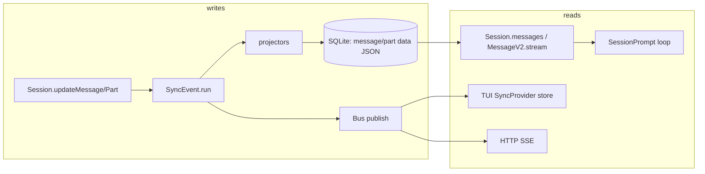

# 08 — Storage, configuration and process-wide state

<!-- toc -->
## Contents

- [1. Filesystem layout (`Global.Path`, `global/index.ts`)](#1-filesystem-layout-globalpath-globalindexts)
  - [1.1 `CACHE_VERSION = "21"` — the sledgehammer](#11-cache_version--21--the-sledgehammer)
- [2. SQLite schema (`session.sql.ts`, `storage/db.ts`)](#2-sqlite-schema-sessionsqlts-storagedbts)
  - [2.1 The `data text` decision](#21-the-data-text-decision)
  - [2.2 PRAGMAs (`db.ts:60`)](#22-pragmas-dbts60)
  - [2.3 Migrations](#23-migrations)
  - [2.4 Event-sourcing side table](#24-event-sourcing-side-table)
  - [2.5 Legacy JSON migration (`json-migration.ts`)](#25-legacy-json-migration-json-migrationts)
- [3. `Database.use` — ambient transaction context](#3-databaseuse--ambient-transaction-context)
- [4. Instance state — the per-directory universe (`src/instance/`, `effect/instance-state.ts`)](#4-instance-state--the-per-directory-universe-srcinstance-effectinstance-statets)
- [5. Configuration — the full precedence chain (`config/config.ts`)](#5-configuration--the-full-precedence-chain-configconfigts)
  - [5.1 Why this order](#51-why-this-order)
  - [5.2 Parsing (`parseConfig`)](#52-parsing-parseconfig)
  - [5.3 Mutating config — two different write paths](#53-mutating-config--two-different-write-paths)
  - [5.4 Side effects on read (not only on write)](#54-side-effects-on-read-not-only-on-write)
  - [5.5 Caching and invalidation](#55-caching-and-invalidation)
- [6. Flags (`src/flag/flag.ts`) — the complete environment surface](#6-flags-srcflagflagts--the-complete-environment-surface)
- [7. Project identity (`project/project.sql.ts`, `src/project/*`)](#7-project-identity-projectprojectsqlts-srcproject)
- [8. Data-flow summary](#8-data-flow-summary)

<!-- /toc -->

Modules: `src/storage/{db.ts,db.bun.ts,schema.sql.ts,storage.ts,json-migration.ts}`,
`src/session/session.sql.ts`, `src/sync/{event.sql.ts,index.ts}`, `src/project/project.sql.ts`,
`src/global/index.ts`, `src/config/config.ts` (1,137 lines), `src/flag/flag.ts`, `src/instance/*`,
`src/effect/instance-state.ts`, `src/filesystem/*`

---

## 1. Filesystem layout (`Global.Path`, `global/index.ts`)

```js
const app = "opencode";
data   = path.join(xdgData,   app);   // ~/.local/share/opencode
cache  = path.join(xdgCache,  app);   // ~/.cache/opencode
config = path.join(xdgConfig, app);   // ~/.config/opencode
state  = path.join(xdgState,  app);   // ~/.local/state/opencode
Global.Path = { home, data, bin: cache/bin, log: data/log, cache, config, state };
```

All five directories are `mkdir -p`'d at module init (top-level `await`), **before** any service runs.

### 1.1 `CACHE_VERSION = "21"` — the sledgehammer

```js
const version = await Filesystem.readText(path.join(cache, "version")).catch(() => "0");
if (version !== CACHE_VERSION) {
  for (const item of await fs.readdir(cache)) await fs.rm(item, { recursive: true, force: true });
  await Filesystem.write(path.join(cache, "version"), CACHE_VERSION);
}
```

[verified] Any bump of a hand-maintained constant **wipes the entire cache directory** (downloads, bins, model
cache, plugin installs). [inferred] This is a deliberate "correctness over incremental cost" trade: previously
installed binaries/models are treated as untrusted after a version change, and there is no per-artifact
versioning to reason about. The cost is re-downloading ripgrep/LSP binaries after upgrades.

`Global.Path.home` honours `OPENCODE_TEST_HOME` — the seam that lets tests simulate a clean home.

## 2. SQLite schema (`session.sql.ts`, `storage/db.ts`)

Tables verified from the bundled migration SQL:

| Table | Columns (abridged) |
|---|---|
| `project` | id PK, worktree, vcs, name, icon_url, icon_color, time_created/updated/initialized, sandboxes, commands |
| `session` | id PK, project_id FK→project CASCADE, parent_id, slug, directory, title, version, share_url, summary_additions/deletions/files/diffs, revert, permission, time_created/updated/compacting/archived, workspace_id |
| `message` | id PK, session_id FK CASCADE, time_created/updated, **data text** |
| `part` | id PK, message_id FK CASCADE, session_id, time_created/updated, **data text** |
| `todo` | session_id, content, status, priority, position; PK(session_id, position) |
| `permission` | project_id PK, time_*, data |
| `session_share` | session_id PK, id, secret, url |
| `event` / `event_sequence` | event-sourcing log: `event(id, aggregate_id, seq, type, data)` |
| `account`, `account_state`, `control_account`, `workspace` | multi-account / workspace support |

### 2.1 The `data text` decision

`message` and `part` store the whole `MessageV2` object as JSON in one column, keeping only the fields needed for
ordering/filtering as real columns (`id`, `session_id`, `time_created`, `time_updated`).

[verified] Consequences visible in the code:
- indexes are *cursor* indexes: `message_session_time_created_id_idx (session_id, time_created, id)` and
  `part_message_id_id_idx (message_id, id)` were added by migration `20260312043431_session_message_cursor`,
  replacing the plain `session_id` / `message_id` indexes;
- no per-part query by content is possible, and schema evolution of parts is a code change only (zod parses the
  JSON on read);
- a part write rewrites the whole row — acceptable because parts are small and writes are per-part.

### 2.2 PRAGMAs (`db.ts:60`)

```sql
PRAGMA journal_mode = WAL;
PRAGMA synchronous = NORMAL;
PRAGMA busy_timeout = 5000;
PRAGMA cache_size = -64000;   -- 64 MB
PRAGMA foreign_keys = ON;
PRAGMA wal_checkpoint(PASSIVE);
```

Read as a design statement: WAL + NORMAL is the standard "one writer, many readers, tolerate last-commit loss on
power failure" profile; `busy_timeout` is the direct answer to "TUI and worker both touch this file";
`wal_checkpoint(PASSIVE)` at open keeps the WAL from growing unbounded across restarts. `OPENCODE_DB` overrides the
path (used for in-memory/temporary DBs).

### 2.3 Migrations

```js
const entries = [ {sql: "...", timestamp: 1769552633000, name: "20260127222353_familiar_lady_ursula"}, … ];
if (Flag.OPENCODE_SKIP_MIGRATIONS) entries.forEach(e => e.sql = "select 1;");
migrate(db, entries);
```

[verified] Migrations are **bundled as literals** (drizzle-generated), not read from disk — again the single-binary
constraint. `OPENCODE_SKIP_MIGRATIONS` is a debug flag that replaces each migration with `select 1` so a developer
can inspect a broken migration without it being applied.

The migration list is itself a changelog of the product: `add_project_commands`, `control_account`, `workspace`,
`add_session_workspace_id`, `account/account_state`, `add_workspace_fields`, `move_org_to_state`,
`session_message_cursor`, `events`.

### 2.4 Event-sourcing side table

`event(aggregate_id, seq, type, data)` + `event_sequence(aggregate_id, seq)` exist alongside the mutable
`session/message/part` tables. `seq` is per aggregate, giving a total order per session.

**Verified refinement (see 15 §6):** these two tables are written **only when
`OPENCODE_EXPERIMENTAL_WORKSPACES` is enabled**. `SyncEvent.run` always allocates a sequence number and always runs
the projector transactionally, but in the default configuration it does not append to the log. `SyncEvent.replay`
implements strict gap detection (duplicate seq ignored, `seq !== latest + 1` throws) for the workspace case.
[inferred] So the log is a dormant capability for cross-instance sync, not part of the normal write path.

### 2.5 Legacy JSON migration (`json-migration.ts`)

`Storage` (file-based JSON KV) predates SQLite. `storage.ts` defines the old on-disk schemas
(`RootFile{path{root}}`, `SessionFile{id}`, `MessageFile{id}`, `DiffFile{additions,deletions}`,
`SummaryFile{id,projectID,summary{diffs}}`), a `file(dir, key)` path builder joining key parts with `.json`, and a
numbered `MIGRATIONS` array (`Storage.migration.1` …) that walks old project/session directories and imports them.
[verified] The migration is driven by a version file read via `parseMigration(text)` → `parseInt` (NaN → 0), so a
missing/corrupt marker means "start from 0". The old storage layer is retained only for this import path.

## 3. `Database.use` — ambient transaction context

```js
function use(callback) {
  try { return callback(ctx.use().tx); }                 // reuse an open transaction
  catch (err) {
    if (err instanceof Context.NotFound) {
      const effects = [];
      const result = ctx.provide({ effects, tx: Database.Client() }, () => callback(Database.Client()));
      for (const effect of effects) effect();            // run post-commit hooks
      return result;
    }
    throw err;
  }
}
```

[verified] Nested `Database.use` joins the outer transaction; effects registered during the transaction run only
after the outermost call returns. [inferred] This is a manual, dependency-free equivalent of a unit-of-work: the
`effects` array is the "after commit" queue used for bus publishes, so an event is never emitted for a write that
later rolls back.

## 4. Instance state — the per-directory universe (`src/instance/`, `effect/instance-state.ts`)

```js
InstanceState.make(init)          // register an Effect-based per-directory cell
InstanceState.get(ref)            // load (once) and return it
InstanceState.useEffect(ref, fn)  // scoped use
Instance.directory / Instance.worktree / Instance.project / Instance.containsPath(p)
Instance.disposeAll()
```

Mechanics (from `effect/instance-state.ts`):

- a `ScopedCache` keyed by the **directory string**;
- values are constructed with the Effect runtime and registered with `addFinalizer` so disposal runs every
  service's cleanup (MCP child processes, LSP clients, share scope, DB handles);
- `InstanceState.get` inside a request obtains the entry for the current instance (`AsyncLocalStorage`-style
  context established by the server middleware / worker call).

[verified] Every stateful service in this document is `InstanceState.make`-scoped: `Provider`, `Agent`, `Skill`,
`Command`, `LSP`, `MCP`, `Permission`, `SessionStatus`, `ToolRegistry`, `ShareNext`, `Plugin`, `Config` (instance
part), `Instruction`. That is why "open two projects in two directories" works inside one process: each has its
own cache entry and its own finalizers.

[inferred] The cost: nothing is shared between directories — provider credentials (`Auth`) and `Global` config are
deliberately outside this scope (global singletons), everything else is duplicated.

## 5. Configuration — the full precedence chain (`config/config.ts`)

`Config.layer` builds `loadInstanceState` which merges sources **in this exact order** (later wins, arrays
concatenated by `mergeConfigConcatArrays`):

1. **Auth `wellknown` entries** — for every auth record of type `wellknown`, `process.env[key] = token`, then
   `GET <url>/.well-known/opencode`, merge `wellknown.config` (scope `global`); failure throws.
2. **Global config** (`getGlobal`) — **all three** of `~/.config/opencode/config.json`, `opencode.json`,
   `opencode.jsonc` are loaded and deep-merged *in that order* (jsonc wins), preceded by a legacy **TOML** migration:
   a file literally named `config` in the config dir is imported as TOML, its `provider`+`model` collapsed into
   `model: "provider/model"`, written out as `config.json` and then `unlink`ed. (`globalConfigFile()` — first
   existing of the three — is only the *write* target for `updateGlobal`.)
3. **`OPENCODE_CONFIG`** — explicit file path.
4. **Project files** — `ConfigPaths.projectFiles("opencode", directory, worktree)` (upward walk to the worktree).
5. **Config directories** — `ConfigPaths.directories()` = `[Global.Path.config, …FS.up(".opencode") from cwd to
   worktree, ~/.opencode, (OPENCODE_CONFIG_DIR)]`. For **every** dir in that list: the `command/`, `agent/`,
   `mode/` and `plugin/` markdown/JS loaders run, plugin origins are recorded, and a **background
   `installDependencies(dir)`** is started (promises collected in `deps`, `waitForDependencies()` awaits them).
   Only for dirs whose name ends in `.opencode` (or equal to `OPENCODE_CONFIG_DIR`) are `opencode.json` then
   `opencode.jsonc` also merged.
6. **`OPENCODE_CONFIG_CONTENT`** — inline JSON (scope `local`).
7. **Active account config** — `GET <account.url>/api/config`, scope `global`, providers registered in
   `consoleManagedProviders`; failures are swallowed at `debug`.
8. **Managed directory** — MDM-style `opencode.json(c)` in `managedDir`, then `readManagedPreferences()`.
9. **`mode` → `agent`** — every legacy `mode` entry becomes a primary-mode agent.
10. **`OPENCODE_PERMISSION`** — JSON merged over `permission`.
11. **`tools` → `permission`** — `tools: {bash: false}` becomes `permission: {bash: "deny"}`, and
    `write|edit|patch|multiedit` all collapse into the single `edit` permission. Applied *after* `permission`, so
    an explicit `permission` still wins.
12. **Defaults** — `username` from `os.userInfo()`; `autoshare:true` → `share:"auto"`; `DISABLE_AUTOCOMPACT` /
    `DISABLE_PRUNE` → `compaction.auto/prune = false`.

A full, code-ordered version of this table with the per-source subtleties (all three global files merged rather
than "the first existing", the TOML migration, which loaders run for which directory) is `18` §1.2.

### 5.1 Why this order

[inferred] The chain encodes a policy: enterprise/MDM last-wins over project, project over user, user over
remote-account defaults, and *auth-provided* remote config first (so an organisation can bootstrap a config before
any file exists). The `mode → agent` and `tools → permission` rewrites are **compatibility shims** kept in the
loader rather than migrated, so old configs keep working forever.

### 5.2 Parsing (`parseConfig`)

```js
const errors = [];
const data = parse(text, errors, { allowTrailingComma: true });   // jsonc-parser
if (errors.length) throw new Config.JsonError({ path, message: `
--- JSONC Input ---
${text}
--- Errors ---
${errorDetails}          // "code at line L, column C" + the source line + a caret
--- End ---` });
```

[verified] Config errors echo the whole file plus caret-marked positions — a deliberately verbose UX for a file
users edit by hand. Schema failures raise `Config.InvalidError{path, issues}` from zod.

`ConfigDirectoryTypoError{path, dir, suggestion}` exists purely to catch a misspelled directory name (e.g.
`~/.config/opencod`) — [inferred] a direct response to a real, common support issue.

One merge rule is worth calling out because it is not last-wins:

- **`instructions` is a union, not an override.** When two sources both define `config.instructions`, the merge
  concatenates and de-duplicates (`Array.from(new Set([...target, ...source]))`), so a project file can add an
  instruction path without dropping the global one. How those entries are expanded and injected is `04` §9.

### 5.3 Mutating config — two different write paths

- **`Config.updateGlobal(patch)`** targets `globalConfigFile()`. If that file ends in `.jsonc`, the patch goes
  through `jsonc-parser.modify`/`applyEdits` with `{insertSpaces:true, tabSize:2}`, recursing per key and skipping
  `undefined` values — **comments and formatting survive**. If the target is `.json` (or `config.json`), the merged
  object is re-serialised with `JSON.stringify(…, null, 2)` instead and comments are lost.
- **`Config.update(patch)`** writes `<instance.directory>/config.json` (never `opencode.json`), then calls
  `Instance.dispose()` so the whole chain re-runs on the next read.

`writable()` strips the internal `plugin_origins` field before either write.

### 5.4 Side effects on read (not only on write)

Loading a config file can change it:

1. **`$schema` injection** — if a successfully parsed file has no `$schema`, the loader sets
   `https://opencode.ai/config.json` in memory *and* rewrites the file textually, swallowing any write error.
2. **Legacy TUI keys are dropped** — top-level `theme`, `keybinds`, `tui` are deleted with a warning (they belong in
   `tui.json`; they are not migrated).
3. **Plugin specs become `file://` URLs** resolved against the config file's directory, and `plugin_origins`
   records `{spec, source, scope}`.

### 5.5 Caching and invalidation

```js
[global, invalidate] = Effect.cachedInvalidateWithTTL(loadGlobal().pipe(orElseSucceed({})), Duration.infinity)
invalidate(wait) = { invalidate(); task = Instance.disposeAll(); if (wait) await task;
                     emit GlobalBus {directory:"global", type: Disposed} }
```

[verified] The **global file layer** is cached per process with an infinite TTL; the **merged config** is cached
per *instance* (`InstanceState`) and dies with it — so "read once per process" is only true of the global files.
`invalidate(wait)` takes a *wait for disposal* flag, not a dependency-cache flag. `loadGlobal` is the only source
that fails soft; everything after it runs in `loadInstanceState`, where a failing `wellknown` fetch throws.

## 6. Flags (`src/flag/flag.ts`) — the complete environment surface

Truthiness helpers (`truthy`, `falsy`, `number`) normalise `"1"/"true"`; a few use `Effect.Config` with defaults.
Verified flags, grouped by purpose:

| Group | Variables |
|---|---|
| Config | `OPENCODE_CONFIG`, `OPENCODE_CONFIG_CONTENT`, `OPENCODE_CONFIG_DIR`, `OPENCODE_DISABLE_PROJECT_CONFIG`, `OPENCODE_TUI_CONFIG`, `OPENCODE_STRICT_CONFIG_DEPS`, `OPENCODE_PERMISSION` |
| Paths/data | `OPENCODE_DB`, `OPENCODE_TEST_HOME`, `OPENCODE_MODELS_URL`, `OPENCODE_MODELS_PATH`, `OPENCODE_FAKE_VCS`, `OPENCODE_GIT_BASH_PATH` |
| Server | `OPENCODE_SERVER_PASSWORD`, `OPENCODE_SERVER_USERNAME`, `OPENCODE_CLIENT` (default `"cli"`), `OPENCODE_DISABLE_EMBEDDED_WEB_UI` |
| Sharing | `OPENCODE_AUTO_SHARE`, `OPENCODE_DISABLE_SHARE` (in `share-next.ts`) |
| Updates | `OPENCODE_DISABLE_AUTOUPDATE`, `OPENCODE_ALWAYS_NOTIFY_UPDATE` |
| Prompts/skills | `OPENCODE_DISABLE_CLAUDE_CODE{,_PROMPT,_SKILLS}`, `OPENCODE_DISABLE_EXTERNAL_SKILLS` |
| Plugins | `OPENCODE_PURE` (skip external plugins), `OPENCODE_DISABLE_DEFAULT_PLUGINS`, `OPENCODE_PLUGIN_META_FILE` |
| Behaviour | `OPENCODE_DISABLE_PRUNE`, `OPENCODE_DISABLE_AUTOCOMPACT`, `OPENCODE_DISABLE_TERMINAL_TITLE`, `OPENCODE_DISABLE_MOUSE`, `OPENCODE_DISABLE_FILETIME_CHECK`, `OPENCODE_DISABLE_CHANNEL_DB`, `OPENCODE_SKIP_MIGRATIONS`, `OPENCODE_AUTO_HEAP_SNAPSHOT`, `OPENCODE_SHOW_TTFD` |
| Experimental | `OPENCODE_EXPERIMENTAL` (umbrella), `_FILEWATCHER`, `_DISABLE_FILEWATCHER`, `_ICON_DISCOVERY`, `_OXFMT`, `_LSP_TY`, `_LSP_TOOL`, `_PLAN_MODE`, `_WORKSPACES`, `_MARKDOWN`, `_BASH_DEFAULT_TIMEOUT_MS`, `_OUTPUT_TOKEN_MAX`, `_EXA`/`ENABLE_EXA`, `_DISABLE_COPY_ON_SELECT`, `ENABLE_EXPERIMENTAL_MODELS`, `ENABLE_QUESTION_TOOL` |
| Never fetched | `OPENCODE_DISABLE_MODELS_FETCH`, `OPENCODE_DISABLE_LSP_DOWNLOAD` |

[verified] The umbrella flag pattern is used consistently: `OPENCODE_EXPERIMENTAL` turns on every `_EXPERIMENTAL_*`
subsystem via `Flag.X = Flag.OPENCODE_EXPERIMENTAL || truthy("X")`. The two exceptions that are *negated* defaults
(`OPENCODE_EXPERIMENTAL_MARKDOWN = !falsy(...)`) show features that are on by default and need an opt-out.

[inferred] `OPENCODE_PURE` (skip external plugins) plus `OPENCODE_DISABLE_DEFAULT_PLUGINS` is the "enterprise /
reproducible" switch: no third-party code executes, which matters for audit and for bug triage.

## 7. Project identity (`project/project.sql.ts`, `src/project/*`)

`project.id` is not the path. `Project.fromDirectory` (`project/project.ts`, 366 lines) derives it in a fixed
order, falling back at every step rather than failing:

```
fromDirectory(dir):
  dotgit   = fs.up(".git", from: dir)[0]                  // nearest ancestor with .git
  if !dotgit          -> {id: ProjectID.global, worktree:"/", sandbox:"/", vcs: <fake>}
  sandbox  = dirname(dotgit)
  id       = readCachedId(dotgit)                          // <dir>/.git/opencode (trimmed text)
  if !git binary      -> {id: id ?? global, worktree: sandbox, sandbox, vcs: <fake>}
  common   = git rev-parse --git-common-dir                // fails -> same fallback as above
  worktree = common == sandbox ? sandbox : dirname(common)
  if !id              -> id = readCachedId(worktree/.git/opencode)
  if !id              -> roots = sorted(git rev-list --max-parents=0 HEAD)
                         id = roots[0]; write it to <worktree>/.git/opencode
  if !id              -> {id: global, ..., vcs: "git"}
  sandbox  = resolve(git rev-parse --show-toplevel)         // failure keeps the earlier sandbox
  return {id, worktree, sandbox, vcs: "git"}
```

The consequences of each choice:

- **Identity is the root commit SHA.** Two clones of the same repository, or the same repo checked out at two paths,
  resolve to the same `project.id` and therefore share project rows, icon, sandbox list and session attribution.
  A repo with several root commits (merged histories) takes the lexicographically first, so the choice is stable but
  arbitrary.
- **The id is cached in `.git/opencode`** so the `rev-list` walk happens once per repository rather than on every
  boot. This is a small write into git's own directory; a read-only `.git` silently skips the write
  (`Effect.ignore`) and recomputes each time.
- **`worktree` and `sandbox` are different things.** `worktree` is the *main* checkout (derived from
  `--git-common-dir`, so a linked `git worktree` maps back to its parent repository); `sandbox` is the *current*
  checkout's top level. `worktree` becomes the instance's `worktree` (see `16` §8), which is why `worktree === "/"`
  is the documented "no project" sentinel.
- **No git, no `.git`, or a failed `rev-parse` degrades to `ProjectID.global`** with the directory still usable as a
  worktree. Nothing in the session layer requires a project.
- **`OPENCODE_FAKE_VCS`** (`Flag`) is parsed with the same zod literal (`"git"`) and substitutes for the detected
  `vcs` on every fallback path — it exists to make the fallbacks testable, and it is the reason `vcs` is typed as a
  literal rather than a string.

After identity, the row is upserted (`onConflictDoUpdate` on `id`) with the refreshed `worktree`, `vcs`,
`time_updated`, and the merged `sandboxes` list; **sandboxes are verified to exist on disk on every boot** and dead
ones are dropped. One migration happens here: sessions previously attributed to `ProjectID.global` whose `directory`
equals this project's worktree are re-pointed to the new id — this is what upgrades a directory opened before its
git identity was known.

`project` table (`project.sql.ts`): `id` (text PK), `worktree`, `vcs`, `name`, `icon_url`, `icon_color`, timestamps,
`time_initialized`, `sandboxes` (JSON text), `commands` (JSON text). `Project.Info` shapes it for the API, with
`icon: {url, override, color}` and `commands: {start}`.

Other operations: `discover()` globs `**/favicon.{ico,png,svg,jpg,jpeg,webp}`, takes the **shortest path** (closest to
the root), encodes it as a `data:` URL and stores it as `icon.url` — only under
`Flag.OPENCODE_EXPERIMENTAL_ICON_DISCOVERY`, only for git projects, and never when an icon already exists. `initGit()`
runs `git init --quiet` for a project whose `vcs` is not git, then re-derives identity. `setInitialized()` records
when `/init` first ran. `addSandbox`/`removeSandbox`/`sandboxes` maintain the list, with `sandboxes()` filtering
non-existent directories on read.

## 8. Data-flow summary



The important asymmetry: **writes go through events, reads go straight to SQLite**. The event stream is for
observers; it is not the read model. That keeps the hot path (building a prompt) free of event replay while still
giving every client a live view.
