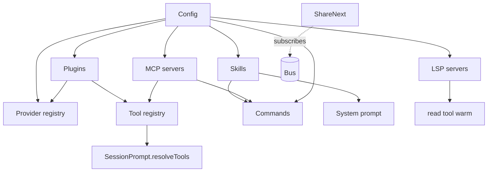

# 09 — Integrations: plugins, MCP, LSP, skills, commands, sharing

<!-- toc -->
## Contents

- [1. Plugins (`src/plugin/index.ts`, `src/plugin/loader.ts`, `src/plugin/{codex,github-copilot/*}`)](#1-plugins-srcpluginindexts-srcpluginloaderts-srcplugincodexgithub-copilot)
  - [1.1 Two plugin generations](#11-two-plugin-generations)
  - [1.2 Internals: the six bundled auth plugins](#12-internals-the-six-bundled-auth-plugins)
  - [1.3 The plugin context](#13-the-plugin-context)
  - [1.4 Hook dispatch](#14-hook-dispatch)
  - [1.5 Failure policy](#15-failure-policy)
  - [1.6 Plugin resolution and config patching (`plugin/shared.ts` 293, `plugin/install.ts` 340)](#16-plugin-resolution-and-config-patching-pluginsharedts-293-plugininstallts-340)
  - [1.6.1 Cloudflare plugins (`plugin/cloudflare.ts`, 56 lines)](#161-cloudflare-plugins-plugincloudflarets-56-lines)
  - [1.7 Plugin metadata (`plugin/meta.ts`, 148 lines)](#17-plugin-metadata-pluginmetats-148-lines)
  - [1.8 The bundled `github-copilot` auth adapter — model discovery (`plugin/github-copilot/models.ts`, 117 lines)](#18-the-bundled-github-copilot-auth-adapter--model-discovery-plugingithub-copilotmodelsts-117-lines)
- [2. MCP (`src/mcp/index.ts`, 633 lines)](#2-mcp-srcmcpindexts-633-lines)
  - [2.1 Transport ladder](#21-transport-ladder)
  - [2.2 Auth state machine](#22-auth-state-machine)
  - [2.3 Tool bridging](#23-tool-bridging)
  - [2.4 Lifecycle and process hygiene](#24-lifecycle-and-process-hygiene)
  - [2.5 Prompt/resource exposure](#25-promptresource-exposure)
  - [2.6 The token store (`src/mcp/auth.ts`, 124 lines)](#26-the-token-store-srcmcpauthts-124-lines)
- [3. LSP (`src/lsp/index.ts`, 421 lines; `src/lsp/{language,client,server,diagnostic}.ts`)](#3-lsp-srclspindexts-421-lines-srclsplanguageclientserverdiagnosticts)
  - [3.1 Server selection](#31-server-selection)
  - [3.2 Lazy spawning with dedupe](#32-lazy-spawning-with-dedupe)
  - [3.3 What the agent gets](#33-what-the-agent-gets)
- [4. Skills (`src/skill/index.ts`, 208 lines)](#4-skills-srcskillindexts-208-lines)
  - [4.1 Discovery](#41-discovery)
  - [4.2 Availability and prompt injection](#42-availability-and-prompt-injection)
  - [4.3 Coupling with compaction](#43-coupling-with-compaction)
  - [4.1 `Discovery` (`skill/discovery.ts`, 76 lines) — remote skill indexes](#41-discovery-skilldiscoveryts-76-lines--remote-skill-indexes)
- [5. Commands (`src/command/index.ts`, 146 lines)](#5-commands-srccommandindexts-146-lines)
  - [5.1 Built-in templates (`command/template/initialize.txt` 68, `tool/task.txt` 62)](#51-built-in-templates-commandtemplateinitializetxt-68-tooltasktxt-62)
- [6. Sharing (`src/share/share-next.ts`, 225 lines)](#6-sharing-srcshareshare-nextts-225-lines)
  - [6.1 Backend selection](#61-backend-selection)
  - [6.2 Event-driven delta sync](#62-event-driven-delta-sync)
  - [6.3 Watched events](#63-watched-events)
  - [6.4 Storage and secrets](#64-storage-and-secrets)
- [7. How the integration ring composes](#7-how-the-integration-ring-composes)

<!-- /toc -->

This document covers the outer ring — everything that brings code or context *into* the agent from outside the
core. All of it is verified from source; inferences are marked.

---

## 1. Plugins (`src/plugin/index.ts`, `src/plugin/loader.ts`, `src/plugin/{codex,github-copilot/*}`)

### 1.1 Two plugin generations

```js
function isServerPlugin(v)    { return typeof v === "function"; }
function getServerPlugin(v)   { return isServerPlugin(v) ? v : (v && typeof v==="object" && "server" in v && isServerPlugin(v.server)) ? v.server : undefined; }
function getLegacyPlugins(mod) { … for each export: getServerPlugin(entry) ?? throw new TypeError("Plugin export is not a function") }
```

- **legacy**: a module exporting one or more `async (input, options) => hooks` functions;
- **v1**: `readV1Plugin(mod, spec, "server", "detect")` — a module with a `server` export and an `id`, registered
  through `resolvePluginId(source, spec, target, id, pkg)`.

`applyPlugin` prefers v1 and falls back to iterating legacy exports. [inferred] The dual path exists because the
plugin format was redesigned (id + client/server split) while published plugins still use the old shape; keeping
both avoids breaking the ecosystem at a version boundary.

### 1.2 Internals: the six bundled auth plugins

```js
const INTERNAL_PLUGINS = [CodexAuthPlugin, CopilotAuthPlugin, gitlabAuthPlugin, PoeAuthPlugin,
                          CloudflareWorkersAuthPlugin, CloudflareAIGatewayAuthPlugin];
```

These are loaded **inside** the Plugin state, before external plugins, and each is wrapped in
`Effect.tryPromise(...).pipe(Effect.option)` so a failing internal plugin logs and is skipped rather than killing
plugin init.

[inferred] Implementing provider auth as plugins rather than in `provider/auth.ts` keeps token refresh, device
flows and vendor-specific quirks out of the core and lets them be disabled or replaced.

### 1.3 The plugin context

```js
const client = createOpencodeClient({
  baseUrl: "http://localhost:4096",
  directory: ctx.directory,
  headers: OPENCODE_SERVER_PASSWORD ? {Authorization: `Basic ${Buffer.from(`${USERNAME ?? "opencode"}:${PASSWORD}`).toString("base64")}`} : undefined,
  fetch: async (...args) => Server.Default().fetch(...args)   // in-process, no socket
});
const input = { client, project, worktree, directory, get serverUrl() {…}, $: Bun.$ };
```

[verified] `fetch` is short-circuited into `Server.Default().fetch`, so a plugin's SDK calls never leave the
process, yet the same `client` works identically in a real HTTP deployment. `Bun.$` is handed over so plugins can
shell out with Bun's tagged template.

### 1.4 Hook dispatch

```js
const trigger = Effect.fn("Plugin.trigger")(function* (name, input, output) {
  for (const hook of hooks) { const fn = hook[name]; if (!fn) continue;
    yield* Effect.promise(async () => fn(input, output)); }
  return output;
});
```

**Hooks mutate the shared `output` object** rather than returning a value. Verified consequence: hook order matters
(later plugins see earlier mutations), and a plugin that returns a new object is silently ignored. Errors from one
`trigger` propagate to the caller — but the `config` hook and the event fan-out are individually try/caught.

Events: `bus.subscribeAll()` → for every event, `hook["event"]?.({event})` for each hook, forked into the scope.
[verified] Plugin event handlers are synchronous calls inside an `Effect.sync`, so an async handler's promise is not
awaited.

Hook names actually invoked in the codebase: `config`, `event`, `experimental.chat.system.transform`,
`experimental.session.compacting`, `chat.params`, `chat.headers`, `tool.execute.before/after` (used by
`fromPlugin`), plus tool/provider contributions via `hook.tool` and `hook.provider`.

### 1.5 Failure policy

```js
PluginLoader.loadExternal({ items, kind: "server", report: { start, missing, error } })
```

`error` distinguishes stages `install`, `compatibility`, `entry`, `load`, and for `install`/`compatibility`/`entry`
it **publishes `Session.Event.Error`** so the failure is visible in the TUI, not just a log line. Missing
entrypoints are only `warn`. Individual `applyPlugin` failures publish an error and continue with the remaining
plugins.

[inferred] The decision to surface plugin failures as session errors is about trust: a plugin that silently fails
to install would otherwise look like "the tool the model is told to use doesn't exist".

### 1.6 Plugin resolution and config patching (`plugin/shared.ts` 293, `plugin/install.ts` 340)

`plugin/shared.ts` is the spec-resolution layer that `index.ts`, `install.ts` and the loader all share:

- **Specifier parsing.** `parsePluginSpecifier(spec)` wraps `npm-package-arg` (`parse10`): an alias with no name
  (e.g. `npm:pkg@*`) yields `{pkg, version}` with `*` normalised to `"latest"`; a bare name is
  `version: "latest"`; anything unparseable is `{pkg: spec, version: ""}`. Path specs are `file://`, a leading
  `.`, or an absolute path (`isPathPluginSpec`, Windows-drive aware), and `pluginSource` reports `"file"` vs `"npm"`.
- **Entrypoint resolution.** `resolvePackageEntrypoint` reads `exports["./<kind>"]` and only falls back to
  `main` for `kind === "server"`. `resolvePackageFile` throws if the resolved entry escapes the plugin directory —
  the path-traversal guard. If no entry is found, `resolvePluginEntrypoint` gives `file://` directory plugins an
  `index.ts|tsx|js|mjs|cjs` lookup (`INDEX_FILES`) and npm plugins a plain `undefined` (a missing-entrypoint warning,
  not an error).
- **Containment and compat checks.** `checkPluginCompatibility` skips entirely when the running version is
  invalid or `0.x`; otherwise it enforces `engines.opencode` as a semver range and throws
  `Plugin requires opencode <range> but running <version>`.
- **Module contract.** `readV1Plugin(mod, spec, kind, mode = "strict")` requires a default export object with
  `server()` **or** `tui()` (never both, never neither), validates the accessors are functions, and in `"detect"`
  mode silently returns when neither key exists. `resolvePluginId` makes `id` mandatory for file plugins and
  otherwise falls back to `package.json.name` (which must be non-empty).
- **Theme declaration.** `readPackageThemes` reads the package's `oc-themes` field: an array of *relative*
  path strings, deduplicated, each resolved inside the plugin dir; absolute entries and non-strings throw
  `TypeError`s. This is the hook that makes a plugin-installed package count as a tui target (see below).
- `isDeprecatedPlugin` matches the two retired auth packages in `DEPRECATED_PLUGIN_PACKAGES`
  (`opencode-openai-codex-auth`, `opencode-copilot-auth`).

`plugin/install.ts` owns two jobs. The first is the `install` *command* proper:

```js
installPlugin(spec, dep = { resolve: resolvePluginTarget })
  → { ok: true, target } | { ok: false, code: "install_failed", error }
readPluginManifest(target)
  → { ok: true, targets } | { ok: false, code: "manifest_read_failed" | "manifest_no_targets", file }
```

`packageTargets(pkg)` decides what the package *is*: a **server** target iff `exports["./server"]` exists or
`main` is a non-empty string; a **tui** target iff `exports["./tui"]` exists or the package declares `oc-themes`.
The second job is `patchPluginConfig(input, dep)`, which edits `opencode.json` / `opencode.jsonc` (chosen via
`patchDir` + `patchName`: global writes to `Global.Path.config`, project writes to `<worktree-or-dir>/.opencode`,
and server vs tui targets patch files named `opencode` vs `tui`). Each target is patched under
`Flock.acquire("plug-config:" + <resolved path>)`, so the read-and-write happens *inside* the lock [verified]:

- parse errors surface as `{code: "invalid_json", line, col, parse}` — line and column are computed from the error
  offset, not guessed;
- missing config means `"{}"`, so patching is idempotent;
- `patchPluginList` dedupes **by spec string or by package name** (`parsePluginSpecifier`'s `pkg`), skipping
  `file://` entries when comparing. Without `force`, an existing duplicate is `{mode: "noop"}`; with `force` it
  replaces the first match and deletes the rest *in descending index order*, keeping `[spec, opts]` tuples
  tuple-shaped by rewriting element 0. Text edits go through `jsonc-parser`'s `modify` with
  `{tabSize: 2, insertSpaces: true}`, so a patched file keeps its original formatting rather than being
  pretty-printed.

### 1.6.1 Cloudflare plugins (`plugin/cloudflare.ts`, 56 lines)

Two auth-only plugins × `provider: "cloudflare-workers-ai"` ("API key" label) and
`"cloudflare-ai-gateway"` ("Gateway API token" label). Each declares prompts **only when the env vars are
absent**: `CLOUDFLARE_ACCOUNT_ID` for both, plus `CLOUDFLARE_GATEWAY_ID` for the gateway — env-driven, so a
fully configured environment asks nothing.

### 1.7 Plugin metadata (`plugin/meta.ts`, 148 lines)

`PluginMeta` is the plugin store's bookkeeping layer. The JSON store lives at
`OPENCODE_PLUGIN_META_FILE ?? `<Global.Path.state>/plugin-meta.json`, and every operation goes through the
`plugin-meta:<file>` Flock with the same read-modify-write shape as the config patching above.

- **Change detection is by fingerprint, not by contents.** For a file plugin the fingerprint is
  `<target>|<mtime(ms, floored)>` — just the file's modified timestamp. For an npm plugin it is
  `<target>|<requested version>|<installed version>` (installed version read from the package's `package.json`).
  A `touchMany` call returns a per-plugin verdict: `"first"` (never seen, `time_changed = now`),
  `"same"` (fingerprint unchanged), or `"updated"` (`time_changed = now`). Every load increments `load_count`
  and sets `last_time`; `first_time` is set once ever. So the *only* way a file plugin is found to have changed
  is its mtime — a content edit that preserves the mtime is invisible. The single batched `touchMany` does one
  read-modify-write for all plugins loaded at once.
- **Theme overrides** are stored per plugin id (`setTheme(id, name, theme)` merges into `entry.themes`), which is
  why the `tui` plugin dialog shows installed themes (§12.6).
- **Failure tolerance.** A missing or corrupt store reads as `{}` — the file is regenerated from scratch on the
  next load rather than erroring.

### 1.8 The bundled `github-copilot` auth adapter — model discovery (`plugin/github-copilot/models.ts`, 117 lines)

`CopilotModels.schema` parses the `/models` response of the Copilot API: each entry needs
`model_picker_enabled`, `id`, `name`, `version`, `capabilities.family/limits{max_context_window_tokens,
max_output_tokens, max_prompt_tokens, vision?}/supports{streaming, tool_calls, …}` — the vision block
optional. `get(baseURL, headers, existing)` fetches with a **5-second `AbortSignal.timeout`**, parses through
`CopilotModels.schema`, and merges: models not present in the remote (filtered to `model_picker_enabled`) are
**deleted from the existing set**; new ones are appended; survivors are rebuilt by `build2`, which keeps prior
fields where present (`temperature`, `reasoning`, `attachment`, `family`, `name`, `options`, `headers`,
`variants`) and derives the rest — `reasoning` from adaptive_thinking/reasoning_effort/thinking budgets,
`image` input capability from `supports.vision` **or** a vision `supported_media_types` entry starting with
`image/`, `release_date` stripped of the `<id>-` prefix when the version starts with it, and `cost` always
**zero** (the adapter never knows the real charges).

## 2. MCP (`src/mcp/index.ts`, 633 lines)

### 2.1 Transport ladder

Remote MCP servers are tried **StreamableHTTP first, then SSE**:

```js
const transports = [
  { name: "StreamableHTTP", transport: new StreamableHTTPClientTransport(new URL(url), {authProvider, requestInit}) },
  { name: "SSE",            transport: new SSEClientTransport(new URL(url), {authProvider, requestInit}) }
];
for (const {name, transport} of transports) { … if (result) return connected; if (lastStatus.needs_auth) break; }
```

[verified] The loop **stops early** on `needs_auth` / `needs_client_registration` — there is no point trying a
second transport when the server rejects credentials. `withTimeout(client.connect(t), timeout ?? 30000)` bounds
each attempt; `acquireUseRelease` closes the transport if the attempt fails.

Timeout defaults are inconsistent and worth knowing: the config schema's `timeout` description says **5000 ms**,
the connect/`listTools` constant is **30 000 ms**, and the per-*tool-call* timeout is `entry.timeout ??
experimental.mcp_timeout` with **no constant fallback** at all. Three numbers for one knob, in one module
(`18` §4.3).

Local servers: `StdioClientTransport{ command, args, cwd: Instance.directory, env: {...process.env, ...(cmd==="opencode" ? {BUN_BE_BUN:"1"} : {}), ...mcp.environment} }` with `stderr: "pipe"` logged.

[verified] `BUN_BE_BUN=1` when the MCP server is `opencode` itself — this is how `opencode mcp serve`-style
self-hosting works inside a Bun-compiled binary.

### 2.2 Auth state machine

```js
Status = connected | disabled | failed{error} | needs_auth | needs_client_registration{error}
```

- `UnauthorizedError` (or a message containing `OAuth`) → `needs_auth`; the transport is stashed in the module-level
  `pendingOAuthTransports` map so a later `opencode mcp auth <key>` can resume it.
- If the message mentions `registration`/`client_id` → `needs_client_registration` with the message
  "Server does not support dynamic client registration. Please provide clientId in config."
- Both cases publish `TuiEvent.ToastShow{title:"MCP Authentication Required", …, duration: 8000}`.

[inferred] Storing the *transport* (not just the URL) is what allows the OAuth callback to complete the same
transport object that failed — a fresh transport would lose the PKCE verifier held in the provider.

### 2.3 Tool bridging

```js
function convertMcpTool(mcpTool, client, timeout) {
  const schema = {...mcpTool.inputSchema, type: "object", properties: props ?? {}, additionalProperties: false};
  return dynamicTool({ description: mcpTool.description ?? "", inputSchema: jsonSchema(schema),
    execute: args => client.callTool({name, arguments: args ?? {}}, CallToolResultSchema,
                                      {resetTimeoutOnProgress: true, timeout}) });
}
```

Two important details: `additionalProperties: false` is forced (LLM tool schemas are closed by default here), and
`resetTimeoutOnProgress: true` means a server streaming progress notifications is not killed by the timeout.

Tool naming is sanitised twice and joined differently per surface — verified inconsistency:
`tools()` uses `` `${sanitize(clientName)}_${sanitize(toolName)}` ``, while `fetchFromClient` (prompts/resources)
uses `` `${sanitize(clientName)}:${sanitize(item.name)}` ``. [inferred] The underscore form is an OpenAI-compatible
tool-name requirement; the colon form is only used for internal maps, so the inconsistency is harmless but is a
real divergence in the code.

### 2.4 Lifecycle and process hygiene

- `state = InstanceState.make(...)` connects **all** configured servers with `concurrency: "unbounded"`.
- `addFinalizer` walks `client.transport.pid`, enumerates descendants with **`pgrep -P`** (BFS in `descendants()`),
  and `SIGTERM`s each, then `client.close()`. [inferred] This is a direct fix for orphaned `npx`/`uvx` wrapper
  processes: killing the pid alone leaves the real server alive.
- `ToolListChangedNotificationSchema` handler re-lists tools, **re-checks** that the client and status are still
  current (two guard checks before and after the await), stores `defs[name]` and publishes `mcp.tools.changed`.
  [verified] The double check is a deliberate guard against a race where a server is disconnected while its
  notification is in flight.
- `MCP.tools()` **fails soft**: a connected server with no cached defs logs `missing cached tools for connected
  server` and contributes nothing.

### 2.5 Prompt/resource exposure

`prompts()` and `resources()` use `collectFromConnected` → `fetchFromClient` → `orElseSucceed(() => undefined)`;
`getPrompt`/`readResource` go through `withClient`, which logs and returns `undefined` if the client is gone. Every
MCP read path is therefore **non-throwing by design**: an unavailable MCP server degrades the feature, not the turn.

---

### 2.6 The token store (`src/mcp/auth.ts`, 124 lines)

Section 2.2 described the auth *flow*; this module is the *store* behind it: `McpAuth`, an Effect service
backed by a single JSON file at `<Global.Path.data>/mcp-auth.json` (written with mode 0600, octal 384). Each entry is `Tokens` (access/refresh token, optional `expiresAt` in **seconds** epoch, and
`scope`), `ClientInfo` (clientId/secret + issue/expiry times), plus the ephemeral `codeVerifier`, `oauthState`,
and `serverUrl` fields the flow carries.

- `all()` reads the whole file every call and swallows read errors to `{}` — no caching at all.
  [inferred] The absence of a cache is deliberate: it means a second opencode process re-reads the other
  process's freshly-written tokens.
- `getForUrl(name, url)` returns the entry **only** if its stored `serverUrl` equals the url — tokens are
  bound to the server they were minted for, so a stale entry from a different endpoint cannot be replayed.
  `set` also stamps `serverUrl` when given.
- The granular updaters (`updateTokens`, `updateClientInfo`, `updateCodeVerifier`, `updateOAuthState`,
  `clearCodeVerifier`, `clearOAuthState`) are generated by two factories (`updateField`/`clearField`), so the
  CRUD surface is data-driven.
- `isTokenExpired` is `false` when there is no token or no `expiresAt`, and otherwise simply
  `expiresAt < Date.now() / 1000` — a seconds-vs-ms comparison that only works because the field is specified
  (and stored) in seconds.

## 3. LSP (`src/lsp/index.ts`, 421 lines; `src/lsp/{language,client,server,diagnostic}.ts`)

### 3.1 Server selection

```js
const cfg = yield* config.get();
if (cfg.lsp === false) → no servers
else {
  for (const server of Object.values(LSPServer)) servers[server.id] = server;   // builtin table
  filterExperimentalServers(servers);                                          // ty vs pyright
  for (const [name, item] of Object.entries(cfg.lsp ?? {})) { … }
}
```

- `cfg.lsp === false` disables everything (a single switch, not per-language).
- Builtin definitions live in `LSPServer` — **37 servers**, each `{id, extensions[], root(file), spawn(root)}`,
  with three root shapes (`NearestRoot(include[], exclude[])`, a constant `Instance.directory`, and bespoke
  resolvers for gradle/cargo/`flake.nix` monorepos). The
  full table, plus how each binary is obtained — four different mechanisms (`Npm.which` 10, package managers 4,
  direct downloads 10, `xcrun` 1) and **12 servers that are `which`-only and cannot install themselves** — is in
  `18` §3.1. `deno` shadows `typescript` by passing `deno.json(c)` as *exclude* patterns, not by
  ordering — `getClients` otherwise spawns every server matching the extension.
- `filterExperimentalServers`: if `OPENCODE_EXPERIMENTAL_LSP_TY` then delete `pyright`, else delete `ty` — the two
  Python servers are mutually exclusive, and the experimental one is opt-in.
- Config entries can disable (`item.disabled`), extend `extensions`, or replace `spawn` entirely with
  `{process: spawn(cmd[0], cmd.slice(1), {cwd: root, env: {...process.env, ...item.env}}), initialization}`.

### 3.2 Lazy spawning with dedupe

`getClients(file)`:

1. `if (!Instance.containsPath(file)) return []` — **no LSP outside the instance**.
2. extension = `path.parse(file).ext || file` (the whole filename for extensionless files like `Makefile`).
3. `schedule(server, root, key)` spawns, then `LSPClient.create({serverID, server, root})`; on any failure it adds
   `key` to `s.broken` and stops the process. A missing handle is recorded as broken too.
4. Existing clients are deduped by `(root, serverID)`.

[verified] `broken` is a permanent per-instance blacklist: a server that fails to start is not retried for the
lifetime of the instance. [inferred] Prevents "spawn fail → retry → spawn fail" loops on every file read.

The finalizer shuts down every client (`Promise.all(clients.map(c => c.shutdown()))`).

### 3.3 What the agent gets

`LSP.Symbol` / `DocumentSymbol` / `Range` / `Status` are zod schemas exposed over the API; `SymbolKind` is the full
LSP enum, and `kinds = [Class, Function, Method, Interface, Variable, Constant, Struct, Enum]` is the documented
subset returned for "workspace symbols" — [inferred] filtering to declaration-like kinds keeps output small and
useful for an agent (fields/properties are noise).

`lsp.updated` is published on `Event.Updated` so the TUI can refresh diagnostics. `read` warms LSP:
`lsp.touchFile(filepath, false).pipe(ignore, forkIn(scope))` — a **forked** touch, so the read returns immediately
and diagnostics arrive later.

[verified] `OPENCODE_DISABLE_LSP_DOWNLOAD` exists, meaning servers are downloaded at runtime; `OPENCODE_EXPERIMENTAL_LSP_TOOL`
gates the `lsp` tool itself.

---

## 4. Skills (`src/skill/index.ts`, 208 lines)

### 4.1 Discovery

```js
EXTERNAL_DIRS = [".claude", ".agents"];
EXTERNAL_SKILL_PATTERN = "skills/**/SKILL.md";
OPENCODE_SKILL_PATTERN = "{skill,skills}/**/SKILL.md";
SKILL_PATTERN = "**/SKILL.md";
```

Sources, in order:

1. `~/.claude` and `~/.agents` (global), unless `OPENCODE_DISABLE_EXTERNAL_SKILLS` (which is itself implied by
   `OPENCODE_DISABLE_CLAUDE_CODE_SKILLS` ⊂ `OPENCODE_DISABLE_CLAUDE_CODE`);
2. every ancestor dir from `directory` up to `worktree` that contains `.claude`/`.agents` (`fsys.up({targets, start, stop})`),
   scanned with `scope: "project"` so scan errors are logged instead of fatal;
3. every config directory, with `{skill,skills}/**/SKILL.md`;
4. `config.skills.paths` — `~/` expanded, relative resolved against the instance directory, non-directories warned;
5. `config.skills.urls` — `Discovery.pull(url)` returns local dirs, which are remembered in `state.dirs`.

`add()` parses frontmatter via `ConfigMarkdown.parse`, requires `{name, description}` (`Skill.Info.pick`), warns on
duplicate names (last one wins by assignment), and records the containing directory in `state.dirs`.

`scan()` scans with `concurrency: "unbounded"` and `discard: true`; a scan error with `opts.scope` is logged, without
it the effect **dies** (fail-fast for built-in scopes).

### 4.2 Availability and prompt injection

```js
available(agent) = all().toSorted(by name).filter(s => Permission.evaluate("skill", s.name, agent.permission).action !== "deny")
```

`SystemPrompt.skills(agent)` returns `undefined` when `skill` itself is denied, otherwise injects:
"Skills provide specialized instructions and workflows… Use the skill tool to load a skill when a task matches its
description." plus `Skill.fmt(list, {verbose:true})` — an XML `<available_skills>` block with `<name>`,
`<description>` and a **`file://` URL** for each skill.

[verified] Only name/description/location are injected; the body is loaded on demand by the `skill` tool. That is
the whole point of the design: N skills cost N short descriptions, not N full documents.
[inferred] `location` as a file URL means the model can also `read` the file directly if it prefers.

### 4.3 Coupling with compaction

`PRUNE_PROTECTED_TOOLS = ["skill"]` in `SessionCompaction` — loaded skill bodies are exempt from pruning, because
they are instructions the agent is actively following.

---

### 4.1 `Discovery` (`skill/discovery.ts`, 76 lines) — remote skill indexes

`SkillDiscovery.pull(url)` fetches `<base>/index.json` (schema `Index = {skills: [{name, files[]}]}`), filters
out entries missing `SKILL.md`, then downloads every listed file (concurrency 4 per skill, 8 per file) into
`<cache>/skills/<skill-name>/`. `download()` skips when the destination exists, and errors anywhere are logged,
never thrown — a failed pull returns an empty list. A skill only counts if `SKILL.md` ended up on disk,
so 404s mid-bundle drop the skill silently.

## 5. Commands (`src/command/index.ts`, 146 lines)

`Command.Info = {name, description?, agent?, model?, source: "command"|"mcp"|"skill", template: string|Promise<string>, subtask?, hints: string[]}`.

Three origins merged into one namespace, **first writer wins** (skill is skipped if a command with that name
exists):

| Origin | Built from |
|---|---|
| builtin | `init` (`initialize_default` with `${path}` → worktree) and `review` (`review_default`, `subtask: true`) |
| config | `cfg.command[name]` |
| MCP | `mcp.prompts()` — template is a **lazy `runPromise` of `getPrompt`**, arguments mapped to `$1…$n` |
| skill | `skill.all()` — template is the skill body, `hints: []` |

`template` is typed `zod.promise(zod.string()).or(zod.string())` and implemented with a getter in each branch —
[verified] this is what lets MCP/skill templates stay unresolved until the command is actually run.

`hints(template)` extracts `$1…$n` (deduped, sorted) and `$ARGUMENTS` — used by the TUI for argument completion.

[inferred] Unifying skills into commands means the composer's slash menu needs one lookup, and `opencode run
/command` works for all three kinds without special cases.

---

### 5.1 Built-in templates (`command/template/initialize.txt` 68, `tool/task.txt` 62)

- `initialize.txt` is the `/init` template: it declares the "Would an agent likely miss this without help?" test,
  `$ARGUMENTS` as user focus, investigation priority (READMEs/manifests → build/test/lint config → CI →
  existing instruction files → `opencode.json`), extract high-signal facts (commands, single-test invocations,
  ordering, monorepo boundaries, toolchain quirks), the one-batch `question` rule, writing rules (omit when in
  doubt), and "improve AGENTS.md in place if it exists" (`${path}`).
- The `task.txt` captured for the system prompt's Task tool description: when/not to delegate, the four usage
  notes (concurrency, return-message, fresh context vs `task_id` resume, trust outputs), and the
  code-reviewer/greeting-responder worked examples — the verbatim text the model receives.

## 6. Sharing (`src/share/share-next.ts`, 225 lines)

### 6.1 Backend selection

```js
const active = yield* account.active();
if (none(active) || !active.value.active_org_id) return { headers: {}, api: legacyApi /* /api/share */, baseUrl: cfg.enterprise?.url ?? "https://opncd.ai" };
const token = yield* account.token(active.value.id);   // throws if missing
return { headers: {authorization: `Bearer ${token}`, "x-org-id": org}, api: consoleApi /* /api/shares */, baseUrl: active.value.url };
```

[verified] Two API shapes (`/api/share` vs `/api/shares`) selected purely by whether the user has an active
organisation — legacy anonymous sharing vs account-scoped sharing.

### 6.2 Event-driven delta sync

```js
sync(sessionID, data) {
  if (disabled) return;
  const existing = queue.get(sessionID);
  if (existing) { for (const item of data) existing.data.set(key(item), item); return; }
  queue.set(sessionID, {data: new Map(data.map(i => [key(i), i]))});
  yield* flush(sessionID).pipe(Effect.delay(1000), catchCause(log), forkIn(scope));
}
```

- **Coalescing key**: `session`, `message/<id>`, `part/<messageID>/<id>`, `session_diff`, `model` — a Map guarantees
  the last version of each entity wins, so a burst of part updates becomes one POST.
- **1 s debounce** via `Effect.delay(1000)` then `flush`; the flush deletes the queue entry, looks up the share
  row, and POSTs `{secret, data:[…]}`; `>= 400` is `warn`, not an error.
- A **missing share row means silent drop** (`if (!share) return`) — data is only uploaded after `create`.

### 6.3 Watched events

`Session.Event.Updated`, `MessageV2.Event.Updated` (which *also* fetches the model for user messages and syncs it
as a `model` item), `MessageV2.Event.PartUpdated`, `Session.Event.Diff`. `full()` re-sends everything (session,
all messages, all parts, diff, models) — used right after `create`.

### 6.4 Storage and secrets

`session_share(session_id PK, id, secret, url)`; `create` upserts. The `secret` is a server-issued shared secret
sent back on every sync/delete — it is the authorisation token for that share, and it lives in SQLite.

[verified] `OPENCODE_DISABLE_SHARE=true|1` makes every method a no-op, and `Session.share` refuses when
`config.share === "disabled"`; `config.share === "auto"` or `OPENCODE_AUTO_SHARE` shares new sessions
automatically, with forked, error-ignoring behaviour.

---

## 7. How the integration ring composes



[inferred] The dependency direction is consistently *inward*: integrations depend on the core (Bus, Config,
Instance, Permission), never the reverse — except through the tool/prompt interfaces. That is what makes it possible
to disable the whole ring (`OPENCODE_PURE`, `lsp:false`, no MCP config) and still have a working agent.
