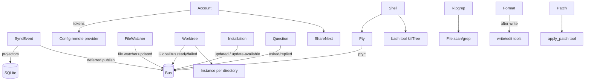

# 15 — Runtime services: pty, installation, format, watcher, ripgrep, sync, control-plane, question, account, worktree, shell, patch

<!-- toc -->
## Contents

- [1. `Pty` — terminal sessions (`src/pty/index.ts`, 310 lines)](#1-pty--terminal-sessions-srcptyindexts-310-lines)
  - [1.1 Shape](#11-shape)
  - [1.2 Creation](#12-creation)
  - [1.3 Output multiplexing and backpressure](#13-output-multiplexing-and-backpressure)
  - [1.4 Reconnect protocol (the interesting part)](#14-reconnect-protocol-the-interesting-part)
  - [1.5 Lifecycle](#15-lifecycle)
- [2. `Installation` — version, method, upgrade (`src/installation/index.ts`, 279 lines)](#2-installation--version-method-upgrade-srcinstallationindexts-279-lines)
  - [2.1 Constants](#21-constants)
  - [2.2 Method detection](#22-method-detection)
  - [2.3 Latest version per channel](#23-latest-version-per-channel)
  - [2.4 Upgrade](#24-upgrade)
- [3. `Format` — automatic formatting after writes (`src/format/index.ts` 161 + `formatter.ts` 436)](#3-format--automatic-formatting-after-writes-srcformatindexts-161--formatterts-436)
  - [3.1 The builtin table (`formatter.ts`, all 26 entries, verified)](#31-the-builtin-table-formatterts-all-26-entries-verified)
- [4. `FileWatcher` (`src/file/watcher.ts`, 134 lines)](#4-filewatcher-srcfilewatcherts-134-lines)
- [5. `Ripgrep` (`src/file/ripgrep.ts`, 315 lines)](#5-ripgrep-srcfileripgrepts-315-lines)
  - [5.1 Resolution order](#51-resolution-order)
  - [5.2 Install](#52-install)
  - [5.3 Output contract](#53-output-contract)
- [6. `SyncEvent` — the event-sourcing core (`src/sync/index.ts`, 167 lines)](#6-syncevent--the-event-sourcing-core-srcsyncindexts-167-lines)
  - [6.1 `run` — versioned, sequenced, transactional](#61-run--versioned-sequenced-transactional)
  - [6.2 `process` — projector, optional event log, deferred publish](#62-process--projector-optional-event-log-deferred-publish)
  - [6.3 `replay` — gap detection](#63-replay--gap-detection)
  - [6.4 Other verified details](#64-other-verified-details)
  - [6.5 Why this design](#65-why-this-design)
- [7. `Question` (`src/question/index.ts`, 150 lines)](#7-question-srcquestionindexts-150-lines)
- [8. `Account` — device-flow auth for the hosted console (`src/account/index.ts`, 273 lines)](#8-account--device-flow-auth-for-the-hosted-console-srcaccountindexts-273-lines)
  - [8.1 Protocol](#81-protocol)
  - [8.2 Token freshness and the refresh cache](#82-token-freshness-and-the-refresh-cache)
  - [8.3 API surface and error mapping](#83-api-surface-and-error-mapping)
  - [7.1 Control-plane workspaces (`control-plane/adaptors/worktree.ts` 40, `control-plane/adaptors/index.ts` 9,](#71-control-plane-workspaces-control-planeadaptorsworktreets-40-control-planeadaptorsindexts-9)
  - [8.0 `account/schema.ts` (58 lines) — the account data definitions](#80-accountschemats-58-lines--the-account-data-definitions)
  - [8.1 `account/repo.ts` (79 lines) — the Account repository](#81-accountrepots-79-lines--the-account-repository)
- [9. `Worktree` (`src/worktree/index.ts`, 410 lines)](#9-worktree-srcworktreeindexts-410-lines)
  - [9.1 Creation](#91-creation)
  - [9.2 Parsing existing worktrees](#92-parsing-existing-worktrees)
- [10. `Shell` (`src/shell/shell.ts`, 96 lines)](#10-shell-srcshellshellts-96-lines)
- [11. `Patch` — the `apply_patch` engine (`src/patch/index.ts`, 489 lines)](#11-patch--the-apply_patch-engine-srcpatchindexts-489-lines)
  - [11.1 Application (`applyHunksToFiles`)](#111-application-applyhunkstofiles)
  - [11.2 Verification before applying (`maybeParseApplyPatchVerified`)](#112-verification-before-applying-maybeparseapplypatchverified)
- [12. `Workspace` / control-plane (`src/control-plane/workspace.ts` 134, `sse.ts` 66)](#12-workspace--control-plane-srccontrol-planeworkspacets-134-ssets-66)
- [13. How these services interlock](#13-how-these-services-interlock)
- [14. `File` — the read/list/search service (`src/file/index.ts`, 601 lines)](#14-file--the-readlistsearch-service-srcfileindexts-601-lines)

<!-- /toc -->

These are the services the agent and UI lean on but that rarely appear in a feature description. Each section is
based on a full read of the file named in its heading.

---

## 1. `Pty` — terminal sessions (`src/pty/index.ts`, 310 lines)

### 1.1 Shape

```js
Pty.Info = {id, title, command, args, cwd, status: "running"|"exited", pid}
Pty.CreateInput = {command?, args?, cwd?, title?, env?}
Pty.UpdateInput = {title?, size?{rows, cols}}
Events: pty.created / pty.updated / pty.exited{exitCode} / pty.deleted
BUFFER_LIMIT = 2 MB ; BUFFER_CHUNK = 64 KB
```

Sessions live in `InstanceState` (`{dir, sessions: Map<PtyID, session>}`) and a finalizer tears every one down
(`process.kill()`, close subscribers).

### 1.2 Creation

```js
command = input.command || Shell.preferred()
args    = input.args || []; if (Shell.login(command)) args.push("-l")
env     = { ...process.env, ...input.env, ...(await plugin.trigger("shell.env", {cwd}, {env:{}})).env,
            TERM: "xterm-256color", OPENCODE_TERMINAL: "1" }
spawnPty(command, args, { name: "xterm-256color", cwd, env })
```

[verified] `-l` is appended for login shells (`bash, dash, fish, ksh, sh, zsh`), the plugin hook `shell.env` can
inject environment variables per directory, and `OPENCODE_TERMINAL=1` is the marker programs can use to detect they
are inside an OpenCode pane.

The native PTY come from `librust_pty` via `spawn` (lazy `import`), so this is one of the few native code paths in
an otherwise pure-JS server.

### 1.3 Output multiplexing and backpressure

```js
proc.onData(chunk => {
  session.cursor += chunk.length
  for (const [key, ws] of session.subscribers) {
    if (ws.readyState !== 1 || ws.data !== key) { delete; continue }
    try { ws.send(chunk) } catch { delete }
  }
  session.buffer += chunk
  if (buffer.length > BUFFER_LIMIT) { excess = len - LIMIT; buffer = slice(excess); bufferCursor += excess }
});
```

[verified] Subscribers are keyed by `ws.data` (an identity token) and pruned on `readyState !== 1` **and** on key
mismatch — the same defensive pattern as the MCP notification handler. The ring-ish buffer keeps the last 2 MB and
tracks `bufferCursor` so a reconnecting client can be given exactly the missing bytes.

### 1.4 Reconnect protocol (the interesting part)

```js
connect(id, ws, cursor):
  from = cursor === -1 ? end : (Number.isSafeInteger(cursor) ? max(0,cursor) : 0)
  if (from < end) send buffer.slice(from - bufferCursor) in 64 KB chunks
  send meta(end)   // frame: [0x00][{"cursor": end}]
  return { onMessage: m => proc.write(String(m)), onClose: cleanup }
```

[verified] The protocol is a **binary-ish framing**: a `0x00` byte followed by JSON metadata carries the server
cursor, while all other frames are raw terminal bytes. `cursor: -1` means "just give me the current state, no
history". If the requested cursor predates the buffer (offset >= buffer.length) the client silently gets nothing —
i.e. **the reconnect is best-effort, not lossless**.

### 1.5 Lifecycle

`onExit` is idempotent (checks `status === "exited"` first), publishes `pty.exited` and then `remove(id)`, which
publishes `pty.deleted`. `resize`/`write` are no-ops when the session is not `running`.

---

## 2. `Installation` — version, method, upgrade (`src/installation/index.ts`, 279 lines)

### 2.1 Constants

```js
Installation.VERSION = VERSION; Installation.CHANNEL = CHANNEL;   // baked at build time
USER_AGENT = `opencode/${CHANNEL}/${VERSION}/${Flag.OPENCODE_CLIENT}`
isPreview() = CHANNEL !== "latest";  isLocal() = CHANNEL === "local"
Events: installation.updated{version}, installation.update-available{version}
```

### 2.2 Method detection

```js
if (execPath includes ".opencode/bin" or ".local/bin") return "curl"
checks = [npm list -g --depth=0, yarn global list, pnpm list -g --depth=0, bun pm ls -g,
          brew list --formula opencode, scoop list opencode, choco list --limit-output opencode]
checks.sort(a,b => execPath.toLowerCase().includes(a.name) ? -1 : …)   // prefer the manager named in the exe path
for each: output.includes(name === brew|choco|scoop ? "opencode" : "opencode-ai") → that manager
return "unknown"
```

[verified] The **reordering by exe path** is what makes `~/.bun/bin/opencode` correctly report `bun` even if npm also
has a global copy. Package name differs per manager (`opencode` vs `opencode-ai`) and is encoded inline.

### 2.3 Latest version per channel

| Method | Source |
|---|---|
| `brew` | `brew info --json=v2 <formula>` when the formula is a tap (`anomalyco/tap/opencode`), else `formulae.brew.sh` API |
| `npm`/`bun`/`pnpm` | `<registry>/opencode-ai/<CHANNEL>` where registry = `npm config get registry` (trailing `/` trimmed) |
| `choco` | `community.chocolatey.org` OData filter `Id eq 'opencode' and IsLatestVersion` |
| `scoop` | `raw.githubusercontent.com/ScoopInstaller/Main/master/bucket/opencode.json` |
| default/unknown | `api.github.com/repos/anomalyco/opencode/releases/latest` → `tag_name` minus leading `v` |

Note the **channel is part of the npm URL** (`opencode-ai/latest`, `…/beta`, …), so preview builds resolve their own
latest. The whole `latestImpl` is wrapped in `Effect.orDie` — a failure to determine the latest version is fatal to
that call, not degradable.

### 2.4 Upgrade

`upgradeCurl(target)`: fetch `https://opencode.ai/install` **as text**, then run `bash` with that text on stdin and
`env: {VERSION: target}`. [verified] This is a remote-script-execution upgrade path, by design: the install script is
the single source of truth for where the binary lives.

Other methods: `npm|pnpm|bun install -g opencode-ai@target`, brew (`tap` + `git pull --ff-only` in the tap repo, then
`brew upgrade`, with `HOMEBREW_NO_AUTO_UPDATE=1`), `choco upgrade opencode --version=… -y`,
`scoop install opencode@target`. Any non-zero exit becomes `UpgradeFailedError{stderr}`, with choco's
"not running from an elevated command shell" substituted when applicable. On success it runs
`<execPath> --version` — a smoke test that the new binary actually works.

`getReleaseType(current, latest)` classifies major/minor/patch via semver.

---

## 3. `Format` — automatic formatting after writes (`src/format/index.ts` 161 + `formatter.ts` 436)

```js
if (cfg.formatter !== false) {
  formatters = { ...builtinFormatters }                       // from formatter.ts
  for (const [name, item] of Object.entries(cfg.formatter ?? {})) {
    if (item.disabled) { delete formatters[name]; continue }
    formatters[name] = {...merge(formatters[name] ?? {}, {extensions: [], ...item}), name, enabled: async () => item.command ?? false}
  }
}
```

Verified behaviour:

- **Detection is lazy and memoised per formatter**: `getCommand(item)` caches either `false` or the command array;
  `item.enabled()` is where a builtin formatter probes for the binary (e.g. `prettier`, `gofmt`, `rustfmt`, `biome`…).
- `getFormatter(ext)` filters builtins by extension, resolves each command, and returns only the enabled ones — so a
  file can be formatted by several tools in sequence.
- `formatFile`: `cmd.map(x => x.replace("$FILE", filepath))`, spawn in the **instance directory** with
  `env: item.environment, extendEnv: true`, wait for exit; non-zero logs `failed` but **does not throw**.
- `Format.status()` is the `formatter` list for the TUI/dialog.
- `cfg.formatter === false` disables everything with one setting (same shape as `lsp: false`).

### 3.1 The builtin table (`formatter.ts`, all 26 entries, verified)

`$FILE` is substituted with the file path; rows marked **literal** return a bare command name rather than the
resolved binary path the `enabled()` probe found.

| Formatter | Extensions | Gate (`enabled()` returns false unless…) | Invocation |
|---|---|---|---|
| `gofmt` | `.go` | `which(gofmt)` | `<bin> -w $FILE` |
| `mix` | `.ex .exs .eex .heex .leex .neex .sface` | `which(mix)` | `<bin> format $FILE` |
| `prettier` | 26 ext: js/ts family, `html/htm/css/scss/sass/less/vue/svelte/json/jsonc/yaml/yml/toml/xml/md/mdx/graphql/gql` | a `package.json` found upward has `prettier` in deps or devDeps **and** `Npm.which("prettier")` | `<bin> --write $FILE` (env `BUN_BE_BUN=1`) |
| `oxfmt` | js/ts family | `Flag.OPENCODE_EXPERIMENTAL_OXFMT` **and** `package.json` has `oxfmt` **and** `Npm.which("oxfmt")` | `<bin> $FILE` (env `BUN_BE_BUN=1`) |
| `biome` | same 26 ext as prettier | `biome.json` or `biome.jsonc` found upward **and** `Npm.which("@biomejs/biome")` | `<bin> format --write $FILE` (env `BUN_BE_BUN=1`) |
| `zig` | `.zig .zon` | `which(zig)` | `<bin> fmt $FILE` |
| `clang-format` | `.c .cc .cpp .cxx .c++ .h .hh .hpp .hxx .h++ .ino .C .H` | `.clang-format` found upward **and** `which(clang-format)` | `<bin> -i $FILE` |
| `ktlint` | `.kt .kts` | `which(ktlint)` | `<bin> -F $FILE` |
| `ruff` | `.py .pyi` | `which(ruff)` **and** (`pyproject.toml` containing `[tool.ruff]`, or `ruff.toml`, or `.ruff.toml`, or any of `requirements.txt`/`pyproject.toml`/`Pipfile` mentioning `ruff`) | **literal** `ruff format $FILE` |
| `air` (`rlang`) | `.R` | `which(air)` **and** `air --help`'s first line contains both `R language` and `formatter` | **literal** `air format $FILE` |
| `uv` | `.py .pyi` | `ruff.enabled()` is false **and** `uv format --help` exits 0 | **literal** `uv format -- $FILE` |
| `rubocop` | `.rb .rake .gemspec .ru` | `which(rubocop)` | `<bin> --autocorrect $FILE` |
| `standardrb` | `.rb .rake .gemspec .ru` | `which(standardrb)` | `<bin> --fix $FILE` |
| `htmlbeautifier` | `.erb .html.erb` | `which(htmlbeautifier)` | `<bin> $FILE` |
| `dart` | `.dart` | `which(dart)` | `<bin> format $FILE` |
| `ocamlformat` | `.ml .mli` | `which(ocamlformat)` **and** `.ocamlformat` found upward | **literal** `ocamlformat -i $FILE` |
| `terraform` | `.tf .tfvars` | `which(terraform)` | `<bin> fmt $FILE` |
| `latexindent` | `.tex` | `which(latexindent)` | `<bin> -w -s $FILE` |
| `gleam` | `.gleam` | `which(gleam)` | `<bin> format $FILE` |
| `shfmt` | `.sh .bash` | `which(shfmt)` | `<bin> -w $FILE` |
| `nixfmt` | `.nix` | `which(nixfmt)` | `<bin> $FILE` |
| `rustfmt` | `.rs` | `which(rustfmt)` | `<bin> $FILE` |
| `pint` | `.php` | a `composer.json` found upward lists `laravel/pint` in `require` or `require-dev` | **literal relative** `./vendor/bin/pint $FILE` |
| `ormolu` | `.hs` | `which(ormolu)` | `<bin> -i $FILE` |
| `cljfmt` | `.clj .cljs .cljc .edn` | `which(cljfmt)` | `<bin> fix --quiet $FILE` |
| `dfmt` | `.d` | `which(dfmt)` | `<bin> -i $FILE` |

Four patterns in this table are load-bearing decisions rather than trivia:

1. **Opt-in by config file where a rewrite is destructive.** `clang-format`, `ocamlformat`, `biome`, `ruff`, `pint`,
   `prettier` and `oxfmt` all require project evidence (a config file or a dependency entry) before they run. A
   binary being installed is *not* sufficient. A project with `rustfmt` on `PATH` and no `rustfmt.toml` still gets
   formatted, because Rust has no per-project opt-out convention — the inconsistency is inherited from the
   ecosystems, not invented here.
2. **`air` is disambiguated by help text.** Several unrelated tools ship a binary called `air`; the probe matches
   `R language` **and** `formatter` in the first line of `air --help` rather than trusting the name. It is the only
   formatter that runs a subprocess to decide whether it exists.
3. **`uv` defers to `ruff`.** `uvformat.enabled()` first calls `ruff.enabled()`, so a project with ruff configured
   never has its Python formatted twice by two different tools. Ordering between prettier and biome is *not*
   similarly resolved — both can be enabled at once and will run in sequence.
4. **Literal names vs resolved paths.** Nine entries return a bare command (`ruff`, `air`, `uv`, `ocamlformat`) or a
   project-relative path (`./vendor/bin/pint`). The bare names rely on `PATH` at spawn time, so a formatter found by
   `which()` earlier can still fail if the environment changes between probe and run; `pint` resolves relative to the
   instance directory, so a PHP project whose `vendor/` sits in a subdirectory is silently unformatted.

[inferred] Formatting is best-effort and invisible on failure by design: a missing formatter must never fail a
write that already succeeded.

---

## 4. `FileWatcher` (`src/file/watcher.ts`, 134 lines)

```js
SUBSCRIBE_TIMEOUT_MS = 10_000
watcher = lazy(() => $createWrapper(require_watcher()))     // native binding, may be absent
getBackend() → "fs-events" (darwin) — other backends are compiled away
```

Init path (inside `InstanceState`):

1. bail if `OPENCODE_EXPERIMENTAL_DISABLE_FILEWATCHER`;
2. resolve backend + binding; if either is missing, log `watcher backend not supported` and **return without error**
   (`FileWatcher.hasNativeBinding()` reports it);
3. if `OPENCODE_EXPERIMENTAL_FILEWATCHER`: subscribe to `Instance.directory` with ignore globs =
   `FileIgnore.PATTERNS + config.watcher.ignore + protecteds(directory)` where `protecteds` keeps only paths inside
   the directory;
4. for git projects, `git rev-parse --git-dir` → subscribe to the VCS dir with **every entry except `HEAD`** ignored
   ([inferred] so index/ref changes are seen but HEAD churn does not spam).

Events map 1:1: `create→add`, `update→change`, `delete→unlink` on `file.watcher.updated`. Subscriptions are wrapped
in `Effect.timeout(10s)` and on timeout the pending subscription is unsubscribed when it eventually resolves — a
leak guard. Finalizer unsubscribes all with `Promise.allSettled`.

[verified] The watcher is **opt-in** (`OPENCODE_EXPERIMENTAL_FILEWATCHER`), not default-on.

---

## 5. `Ripgrep` (`src/file/ripgrep.ts`, 315 lines)

### 5.1 Resolution order

```js
system = which("rg"); if (stat(system)?.isFile()) return {filepath: system}
filepath = join(Global.Path.bin, "rg")
if (!exists(filepath)) { download }
```

`PLATFORM` table maps `x64-darwin → x86_64-apple-darwin`, `arm64-darwin → aarch64-apple-darwin`,
`x64-linux → x86_64-unknown-linux-musl`, `arm64-linux → aarch64-unknown-linux-gnu`, `*-win32 → aarch64/x86_64-pc-windows-msvc`,
with `tar.gz` vs `zip` extensions. `version = "14.1.1"`; URL is the BurntSushi GitHub release.

### 5.2 Install

- download → write archive → `tar -xzf <archive> --strip-components=1` with platform-specific include flags
  (`--include=*/rg` on darwin, `--wildcards */rg` on linux) — differences in GNU vs BSD tar;
- Windows: `ZipReader`/`BlobReader` (fflate) finds `rg.exe` and writes it, no external unzip;
- delete the archive, `chmod 493` (0755) on non-Windows.

Typed errors: `UnsupportedPlatformError{platform}`, `DownloadFailedError{url,status}`, `ExtractionFailedError{filepath,stderr}`.

### 5.3 Output contract

`rg --json` events are modelled with zod: `begin`, `match` (`path.text`, `lines.text`, `line_number`,
`absolute_offset`, `submatches[{match,start,end}]`), `end` (`binary_offset`, `stats`), `summary`
(`elapsed_total`, `stats`). `File.scan` consumes `Ripgrep.files({cwd})`; `grep` consumes matches.

[inferred] Parsing `rg --json` with a discriminated union (instead of `--vimgrep` text) is what lets `grep` report
per-submatch spans and binary detection to the model.

---

## 6. `SyncEvent` — the event-sourcing core (`src/sync/index.ts`, 167 lines)

This is the most consequential module read in this pass; it changes the picture from `04` §5.

```js
SyncEvent.define({type, version, aggregate, schema, busSchema?})   // throws if frozen
SyncEvent.init({projectors: Map<def, fn>, convertEvent?})          // freezes the registry
SyncEvent.run(def, data)
SyncEvent.replay(event, {republish})
SyncEvent.remove(aggregateID)
SyncEvent.subscribeAll(handler)   // EventEmitter "event"
```

### 6.1 `run` — versioned, sequenced, transactional

```js
agg = data[def.aggregate]; if (agg == null) throw
if (def.version !== versions.get(def.type)) throw "running old versions of events is not allowed"
Database.transaction(tx => {
  id = EventID.ascending()
  row = select seq from event_sequence where aggregate_id = agg
  seq = row ? row.seq + 1 : 0
  process(def, {id, seq, aggregateID: agg, data}, {publish: true})
}, {behavior: "immediate"})
```

### 6.2 `process` — projector, optional event log, deferred publish

```js
projector = projectors.get(def); if (!projector) throw "Projector not found for event: …"
Database.transaction(tx => {
  projector(tx, event.data)
  if (Flag.OPENCODE_EXPERIMENTAL_WORKSPACES) {
    tx.insert(event_sequence).values({aggregate_id, seq}).onConflictDoUpdate(...).run()
    tx.insert(event).values({id, seq, aggregate_id, type: versionedType(def.type, def.version), data}).run()
  }
  Database.effect(() => {
    Bus.emit("event", {def, event})                       // internal emitter
    if (options.publish) { const r = convertEvent(def.type, event.data);
      r instanceof Promise ? r.then(d => Bus.publish(...)) : Bus.publish({type: def.type, properties: def.schema}, r) }
  })
})
```

**Correction to what earlier drafts implied:** the persistent `event`/`event_sequence` log is written **only when
`OPENCODE_EXPERIMENTAL_WORKSPACES` is on**. In the default configuration the sequence is still allocated and the
projector still runs transactionally, but nothing is appended to the log tables. Publishing is deferred via
`Database.effect`, so no bus event escapes a transaction that later rolls back.

### 6.3 `replay` — gap detection

```js
latest = select seq where aggregate_id … ?? -1
if (event.seq <= latest) return                       // idempotent
if (event.seq !== latest + 1) throw `Sequence mismatch for aggregate "…": expected X, got Y`
process(def, event, {publish: !!options.republish})
```

[verified] Replay is strict: duplicates are ignored, gaps are an error, and publication is opt-in. This is the
mechanism a workspace client would use to catch up — and it is exactly why event ids are ordered.

### 6.4 Other verified details

- `payloads()` builds a generated zod union of every registered event, tagged `ref: "SyncEvent.<type>"` — the OpenAPI
  schema for the event stream is derived from the registry, not hand-written.
- `init` re-defines every event on the **Bus** (`BusEvent.define(type, properties ?? schema)`) after registering
  versions — the bus registry is rebuilt from the sync registry, so the two cannot diverge.
- `SyncEvent.remove(aggregateID)` deletes both the sequence and the events for an aggregate (used when a session is
  deleted).
- `reset()` exists for tests: unfreezes, drops projectors, resets `convertEvent`.

### 6.5 Why this design

[inferred] `run(def, data)` takes the *payload* and derives the aggregate id from it, so callers cannot forget the
aggregate. The version check makes schema evolution explicit: you cannot write an event with an outdated shape, and
`versionedType` means old rows remain readable under `type.1`. Deferred publish keeps "bus saw it" equivalent to
"transaction committed", which is the invariant the TUI's `reconcile` depends on.

---

## 7. `Question` (`src/question/index.ts`, 150 lines)

```js
pending: Map<id, {info, deferred}>
ask(input):
  deferred = Deferred.make(); pending.set(id, {info, deferred})
  return yield* Effect.ensuring(Deferred.await(deferred), Effect.sync(() => pending.delete(id)))
reply({requestID, answers}) → deferred.succeed(answers)
reject → Deferred.fail(new RejectedError)
addFinalizer → every pending Deferred.fail(RejectedError), then clear
```

Verified properties:

- **Exactly the same shape as the permission ask** (Deferred per request, finalizer rejection) — but unlike
  permissions there is no ruleset, no "always", and no persistence: questions are always interactive.
- The rejection error `QuestionRejectedError` is what `SessionProcessor` catches as a *blocking* outcome (04 §3) and
  what `plan_exit` throws when the user says "No" (06 §3).
- The TUI's `QuestionPrompt` (`13` §7) is the only producer of replies; `run` denies the tool outright.

Fields used by callers: `questions[]` with `question`, `header`, `options[{label, description}]`, `multiple`,
`custom` (whether a free-text answer is offered), plus `sessionID` and an optional `tool{messageID, callID}`.

---

## 8. `Account` — device-flow auth for the hosted console (`src/account/index.ts`, 273 lines)

### 8.1 Protocol

```js
clientId = "opencode-cli"
login(server):      POST {server}/auth/device/code  {client_id} → {device_code, user_code, verification_uri_complete, expires_in, interval}
poll({server, code}): POST {server}/auth/device/token {grant_type:"urn:ietf:params:oauth:grant-type:device_code", device_code, client_id}
                     → union(DeviceTokenSuccess | DeviceTokenError)
DeviceTokenError.toPollResult(): authorization_pending→PollPending, slow_down→PollSlow,
                                 expired_token→PollExpired, access_denied→PollDenied, else PollError
refreshToken(row):  POST {url}/auth/device/token {grant_type:"refresh_token", refresh_token, client_id}
```

[verified] Standard OAuth 2.0 device grant, hand-rolled over Effect's HttpClient with `Schema.Class` request/response
models — no third-party auth library.

### 8.2 Token freshness and the refresh cache

```js
eagerRefreshThreshold = Duration.minutes(5); eagerRefreshThresholdMs = toMillis(...)
isTokenFresh(expiry, now) = expiry != null && expiry > now + 5min
refreshTokenCache = Cache.make({capacity: Infinity, timeToLive: Duration.zero, lookup: accountID => {
   row = repo.getRow(accountID); if fresh → access_token; else refreshToken(row)
}})
resolveToken(row) = fresh(row) ? row.access_token : Cache.get(refreshTokenCache, row.id)
```

[verified] The 5-minute **eager refresh window** means a token about to expire is renewed before use. The cache has
`timeToLive: 0`, which in Effect means "no expiry" — it is purely a request-coalescing cache (concurrent callers
share one refresh); correctness comes from the freshness check, not from the cache.

### 8.3 API surface and error mapping

`active`, `list`, `activeOrg` (requires `account.active_org_id` **and** that the org still appears in the fetched org
list), `orgs`, `orgsByAccount` (concurrency 3), `config(accountID, orgID)` (GET `/api/config` with `x-org-id`, 404 →
`Option.none`), `token`, `switchOrg`, `login`, `poll`, `remove`, `use`.

Every HTTP failure is mapped through `mapAccountServiceError(message)` into `AccountServiceError{message, cause}` —
one error type for the whole service. Read requests use `withTransientReadRetry`.

---

### 7.1 Control-plane workspaces (`control-plane/adaptors/worktree.ts` 40, `control-plane/adaptors/index.ts` 9,
`control-plane/types.ts` 15, `control-plane/schema.ts` 12, `control-plane/workspace.sql.ts` 14, `share/share.sql.ts` 13,
`lsp/launch.ts` 16)

`WorkspaceInfo = {id, type, branch?, name?, directory?, extra?, projectID}`; the `workspace` table has a
cascade FK to ProjectTable and an `extra` JSON column. The **worktree adaptor** is the default (and only)
registered one (`ADAPTORS = {worktree: lazy(WorktreeAdaptor)}`): `configure` creates a worktree via
`Worktree.makeWorktreeInfo` and returns the filled `WorkspaceInfo`; `create`/`remove` go through
`Worktree.createFromInfo/remove` (all three fields required by the `Config` strict extension); `fetch`
throws `"fetch not implemented"` — the interface exists for a future remote adaptor.
`share/share.sql.ts` (13): the `session_share` table (PK `session_id` FK-cascading to SessionTable,
`id`, `secret`, `url`, timestamps) behind the share routes (§7).

### 8.0 `account/schema.ts` (58 lines) — the account data definitions

Branded ids (`AccountID`, `OrgID`) and token newtypes, `Info = {id, email, url, active_org_id: null|OrgID}`,
`Org = {id, name}`, and the durable account tables (`account.sql.ts`, 28): `account` (id, email, url, access/refresh tokens,
token_expiry, timestamps), `account_state` (singleton id, `active_account_id` → FK onDelete `set null`,
active_org_id) and `control_account` (PK over (email, url), an `active` boolean default false). The
device-flow poll types: `Login = {code, user, url, server, expiry, interval}` and
the `PollResult` union `PollSuccess{email} | PollPending | PollSlow | PollExpired | PollDenied | PollError{cause}`.

### 8.1 `account/repo.ts` (79 lines) — the Account repository

`AccountRepo` is the Drizzle-backed repository for the account store (tables `AccountStateTable`/`AccountTable`
from `account/sql.ts`):

- `active()` reads the singleton state row (id 1)'s `active_account_id`, joins the account row, decodes as
  `Info` with `active_org_id`; `list()` decodes all accounts with a null `active_org_id`.
- `use(accountID, orgID)` upserts the singleton state row with the *provided* ids; `remove(accountID)` clears the
  singleton's fields for that account (update → nulls) and deletes the account row, in a transaction; `getRow`
  is the raw row as an Option.
- `persistToken` writes tokens + `token_expiry`; `persistAccount` upserts the account row (email/url/tokens/
  expiry) and, **in the same transaction**, sets the singleton state — so a newly-persisted account becomes
  active atomically.
- Every error wraps as `AccountRepoError("Database operation failed", {cause})` — including a wrapped DB
  failure, not a silent retry. (No transaction on the read paths; they can't change anything.)

## 9. `Worktree` (`src/worktree/index.ts`, 410 lines)

```js
NotGitError, NameGenerationFailedError, CreateFailedError, StartCommandFailedError, RemoveFailedError, ResetFailedError
Events: worktree.ready, worktree.failed (emitted on GlobalBus with {directory, payload})
```

### 9.1 Creation

```js
root = join(Global.Path.data, "worktree", project.id)          // NOT inside the repo
base = name ? slugify(name) : ""
candidate(root, base): for attempt in 0..25:
   name = base ? (attempt === 0 ? base : `${base}-${Slug.create()}`) : Slug.create()
   branch = `opencode/${name}`; directory = join(root, name)
   skip if directory exists; skip if `git show-ref --verify --quiet refs/heads/<branch>` succeeds
   return {name, branch, directory}
setup: git worktree add --no-checkout -b <branch> <dir>   (cwd = main worktree) ; project.addSandbox(...)
boot:  git reset --hard                                    (populates the not-checked-out tree)
       Instance.provide({directory, init: InstanceBootstrap})    // bootstrap the new instance
       GlobalBus.emit(worktree.ready | worktree.failed)
       runStartScripts(directory, {projectID, extra})
```

Verified subtleties:

- **`--no-checkout` then `reset --hard`**: creation returns fast; population happens asynchronously, and failures are
  reported as a `worktree.failed` event rather than a thrown error. `create()` forks `boot` into the scope, so the
  caller gets the `Info` before the checkout finishes.
- **26 attempts** to find a free name (`MAX_NAME_ATTEMPTS`), then a typed error.
- Worktrees live under the data dir keyed by project id, so they never pollute the repository.
- `addSandbox` records the directory on the project row (that is what `project.sandboxes` is for).
- `startCommand` is passed to `runStartScripts` as `extra`, so a per-worktree setup command can run after bootstrap.

### 9.2 Parsing existing worktrees

`parseWorktreeList(text)` parses `git worktree list --porcelain`-style output into `{path, branch}` entries, and
`canonical()` resolves realpaths so the same worktree reported two ways is not treated as two. `reset()` and
`remove()` exist with corresponding typed errors.

---

## 10. `Shell` (`src/shell/shell.ts`, 96 lines)

```js
BLACKLIST = {fish, nu}; LOGIN = {bash,dash,fish,ksh,sh,zsh}; POSIX = {bash,dash,ksh,sh,zsh}
SIGKILL_TIMEOUT_MS = 200
killTree(proc, {exited}): kill(-pid, SIGTERM); wait 200ms; if !exited kill(-pid, SIGKILL)
                          catch → proc.kill(SIGTERM); wait; proc.kill(SIGKILL)
preferred = lazy(select(process.env.SHELL))
acceptable = lazy(select(process.env.SHELL, {acceptable: true}))   // refuses BLACKLIST
fallback(): "/bin/zsh" on darwin (compile-time branch), else which("bash") ?? "/bin/sh"
```

[verified] `killTree` targets the **process group** (`-pid`) — the correct primitive for shells that spawn children
(`bash -c "a | b"`). The 200 ms grace before SIGKILL is hardcoded. `select` refuses blacklisted shells only when
`acceptable` is requested; `preferred` accepts any `$SHELL`. The Windows branches (`gitbash()`,
`windowsPath`, `pwsh`/`powershell` picking) exist but are compiled out on darwin (`if (true) return "/bin/zsh"`).

---

## 11. `Patch` — the `apply_patch` engine (`src/patch/index.ts`, 489 lines)

Two layers are exported:

- **Court-level API**: `parsePatch(text)` → `{hunks}`, `deriveNewContentsFromChunks(path, chunks)`,
  `applyHunksToFiles(hunks)`, `applyPatch(text)`; plus `maybeParseApplyPatch`, `maybeParseApplyPatchVerified`.
- **Argv-based**: `maybeParseApplyPatch(argv)` understands the Codex-style `apply_patch` **command line**
  (`apply_patch <<'PATCH' … PATCH`), returning `{type:"Body", args:{patch, hunks, workdir}}`,
  `{type:"PatchParseError"}`, or `{type:"NotApplyPatch"}`.

### 11.1 Application (`applyHunksToFiles`)

```js
case "add":    write(hunk.path, contents)
case "delete": unlink(hunk.path)
case "update": r = deriveNewContentsFromChunks(path, chunks)
               if (hunk.move_path) { mkdir(dirname(move_path)); write(move_path, r.content); unlink(path) }
               else write(path, r.content)
→ {added, modified, deleted}
```

### 11.2 Verification before applying (`maybeParseApplyPatchVerified`)

```js
if (argv.length === 1) { try { parsePatch(argv[0]); return {type:"CorrectnessError", error: ImplicitInvocation} } catch {} }
```

[verified] A **lone patch body as the first argument is rejected** with `ImplicitInvocation` — the engine refuses to
guess that a bare string is a patch. The verified form then resolves each hunk path against
`args.workdir ? resolve(cwd, workdir) : cwd`, and for `delete` it must first *read* the file (failure →
`CorrectnessError("Failed to read file for deletion: …")`); for `update` it derives the new content up front
(failure → `CorrectnessError(error)`). The result is a `changes: Map<resolvedPath, {type, content|unified_diff|new_content, move_path}>`
so the caller (the `apply_patch` tool) can present a diff and ask permission **before** touching disk.

[inferred] The two-phase design (verify → apply, with a precomputed change map) is what makes `apply_patch`
permission-friendly: the same map is the diff shown in the approval prompt and the work to be done afterwards.

---

## 12. `Workspace` / control-plane (`src/control-plane/workspace.ts` 134, `sse.ts` 66)

```js
Workspace.Info = {id, type, branch, name, directory, extra, projectID}
Workspace.Event = {Ready{name}, Failed{message}}
create(input): id = WorkspaceID.ascending(input.id)
               adaptor = await getAdaptor(input.type)
               config = await adaptor.configure({...input, id, name:null, directory:null})
               insert into workspace table
```

Verified: workspace types are resolved through an **adaptor registry** (`control-plane/adaptors`), and the adaptor
decides how a workspace is materialised (branch/name/directory/extra). Rows are stored in the `workspace` table
(`id, type, branch, name, directory, extra, project_id`) which migration `20260303231226_add_workspace_fields`
replaced the earlier single `config` column with.

`sse.ts` is a generic SSE client (CRLF normalisation, `id:`/`retry:` tracking, non-JSON payloads surfaced as
`{type:"sse.message"}` events) — read in full and documented in `16` §10.6. The
`OPENCODE_EXPERIMENTAL_WORKSPACES` flag gates the persistent event log (§6.2) that workspace sync depends on, so the
feature is coherent only with that flag on.

---

## 13. How these services interlock



[inferred] Every one of these is a **passive service**: it exposes methods and publishes events, but nothing in this
layer decides what the agent does. The only service here that participates in the turn loop is `Question` (it blocks
a tool) and `SyncEvent` (it is the write path). Everything else is infrastructure the turn happens to need.

## 14. `File` — the read/list/search service (`src/file/index.ts`, 601 lines)

This is the service behind `File.read/list/search/status` (the `file` reads, the glob/grep support queries and the
TUI's file dialogs); the *watcher* is `file/watcher.ts` and ripgrep is `file/ripgrep.ts` (above). `File.Info`,
`File.Node`, `File.Content` are the zod schemas for changed-file rows, tree nodes and file content (text/binary +
optional diff/patch + optional base64 encoding + mime type). `File.Event.Edited` (`file.edited`) is the only bus
event the module defines; `File.Service` is provided through `File.defaultLayer` with a per-instance runtime.

Its cache is the part worth understanding. `File.scan()` builds `{files, dirs}` once per instance and caches the
*effect* (`cachedScan`); `File.init`/`File.search` call `ensure()` which runs the cached scan once and then
re-scans — an Effect cache being refreshed after first use, not a TTL. Two completely different scans are selected
by project kind:

- **Global home** (`Instance.directory === Global.Path.home` and project id `"global"`): a hand-rolled two-level
  scan of top-level directories plus their immediate subdirectories, skipping dotfiles, `Protected.names()`, and
  `node_modules/dist/build/target/vendor` at the second level. It produces `dirs` only.
- **Project mode**: a single `Ripgrep.files({cwd})` call (so the scan respects `.gitignore` exactly as grep does),
  then all ancestor directories are synthesised from file paths and deduplicated via `seen`. It produces `files`
  plus `dirs`.

`search()` is fuzzy over that cache: `fuzzysort.go(query, items, {limit})` with `limit ?? 100`, `type` defaulting
to `"file"` when `input.dirs === false` and `"all"` otherwise; **directory searches fetch `limit * 20` candidates**
before hidden-last sorting and trimming back to `limit`, so hidden dirs do not crowd out visible ones.

`File.read()` is where classification lives. It rejects paths outside the project with `"Access denied: path
escapes project directory"`, then decides by extension tables (counted from the source: `binary2` 93
extensions, `image` 25, `text8` 41, `textName` 9 well-known filenames, plus a 16-entry explicit mime table):

- **Image by extension** → read the bytes and return them as **base64 `text`** with the resolved mime type; if the
  file doesn't exist, an empty `text`. Images are thus always “text” to the model regardless of whether the
  filesystem has them.
- **Known binary extension** not in the text tables → `{type: "binary", content: ""}` (never read at all).
- Otherwise the *detected* mime type is consulted: `shouldEncode` returns true for `image/audio/video/font/model/multipart`
  top-level types, false for `text/*` and for anything with a `charset=`. Encodable non-images again return
  `binary` with the mime type.
- Text reads are `.trim()`ed, and in git projects a `git diff [--] file` plus a `--staged` fallback fetch produces
  a unified `structuredPatch` (full context, whitespace-insensitive) rendered by `formatPatch`, both attached to
  the content. A missing file before that is an empty string.

`File.list(dir)` merges git ignore rules from both `.gitignore` and `.ignore` (via the `ignore` package) into one
matcher, excludes `.git` and `.DS_Store`, computes `ignored` as `file + "/"` for directories, and sorts
directories-first then by name. `status()` derives changed files from `git diff --numstat HEAD` (`-` → `0`),
`git ls-files --others --exclude-standard` (untracked, line count = file's line count), and
`git diff --name-only --diff-filter=D` (deleted), all with `core.fsmonitor=false` + `core.quotepath=false`, and
makes everything relative to the instance directory.
